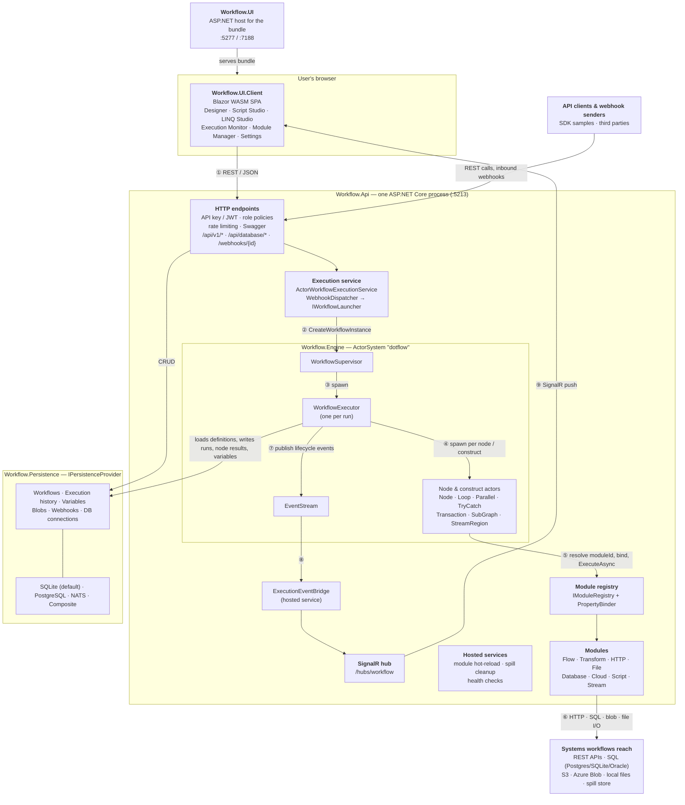
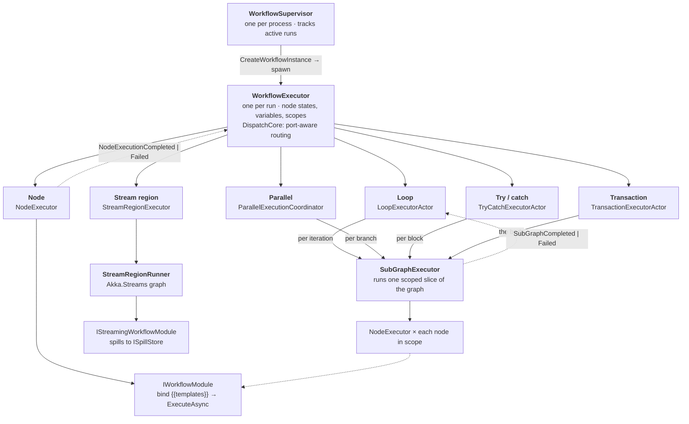
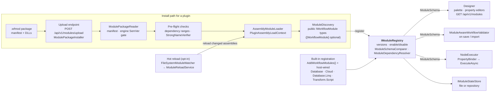
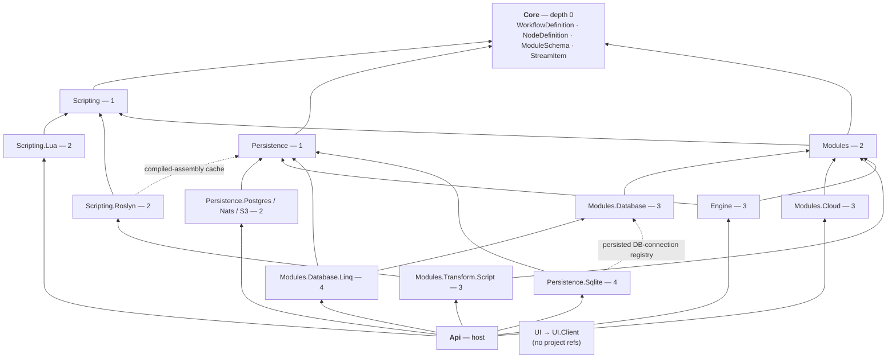

# Architecture overview

> How DotFlow is put together: processes, the engine, the module system, the project graph and
> persistence. Drawn from the source at commit `7b8011e` (branch `feature/FSL`), not from the phase
> plans. A richer visual version of this page is in [`overview.html`](overview.html). Open it in a
> browser.

**Contents:** [System overview](#1-system-overview) · [Inside a run](#2-inside-a-run) ·
[Module system](#3-module-system) · [Project layers](#4-project-layers) ·
[Persistence](#5-persistence) · [Observations](#6-observations)

DotFlow is a visual workflow engine on .NET 8:

- A Blazor WebAssembly designer builds workflow graphs.
- A single ASP.NET Core process stores and runs them.
- Each run becomes a tree of Akka.NET actors that call pluggable modules (HTTP, SQL, files, cloud
  storage, scripts).
- Persistence is swappable per store.

| | |
| --- | --- |
| Projects | 22 in `Workflow.sln`, plus `Workflow.Persistence.S3` outside it |
| Target | `net8.0` throughout |
| Tests | ~2,400 xUnit/bUnit test methods in 3 suites |
| Key libraries | Akka.NET 1.5, linq2db, Roslyn, Jint, MoonSharp, Polly, LanguageExt |

---

## 1. System overview

Two processes, one engine, pluggable edges. Everything that executes lives in `Workflow.Api`:

- the HTTP surface
- the SignalR hub
- the Akka actor system
- the module registry
- the scripting engines

`Workflow.UI` only serves the WebAssembly bundle. The SPA then talks to the API directly.

**The run path, step by step**

1. The designer, an SDK or a third-party webhook calls `POST /api/v1/workflows/{id}/execute`.
   Authentication (API key or JWT) runs first, then a role policy such as `WorkflowExecutePolicy`.
2. `ActorWorkflowExecutionService` sends `CreateWorkflowInstance` to the singleton
   `WorkflowSupervisor`. Webhooks take the same route through `WebhookDispatcher` and
   `ActorWorkflowLauncher`.
3. The supervisor resolves the definition from `IWorkflowRepository` and spawns one
   `WorkflowExecutor` for the run. The executor hydrates variables from `IVariableStore`.
4. The executor walks the graph with `DispatchCore` and spawns a child actor per ready node. Each
   loop, parallel block, try/catch, transaction and streaming region gets its own supervising actor.
5. A `NodeExecutor` looks the node's `ModuleId` up in `IModuleRegistry`. It binds properties through
   `PropertyBinder`, which expands `{{…}}` templates, and then calls `ExecuteAsync`.
6. The module does real I/O: HTTP with Polly resilience, SQL via linq2db, S3 or Azure Blob,
   sandboxed file access, or a JS / C# / Lua script.
7. The executor records node results and status in `IExecutionHistoryRepository`. It publishes
   `NodeStateChanged`, `ProgressUpdate` and similar events to the Akka `EventStream`.
8. `ExecutionEventBridge`, a hosted service, subscribes to those events. It queues them on a
   channel so a slow client never blocks the engine, then forwards them to hub groups.
9. The SPA's `RealTimeClient` receives the pushes. The designer run overlay and the Execution
   Monitor update live.

Full detail: [01 — Execution lifecycle](01-execution-lifecycle.md).

---

## 2. Inside a run

Every control construct is its own actor. In the graph, control flow is just more nodes
(`builtin.loop.foreach`, `builtin.trycatch`, …). In the engine, each of those nodes becomes a
dedicated actor that owns a scoped sub-graph. Each construct therefore gets its own:

- timeout
- cancellation token, linked to its parent's
- failure boundary

**Batch by default.** A trigger produces one run that traverses the graph once. Node outputs are
stored per node and port, and downstream inputs bind from them (`{{input}}`, `{{nodeId.port}}`,
`{{Variable.x}}`). Template expansion is opt-in per schema field, so upstream data can't read your
secrets. See [02 — Data binding & variables](02-data-binding-and-variables.md).

**Streaming regions (Phase 5.1).** `StreamRegionDetector` finds maximal groups of nodes joined by
stream-typed ports. It works from schemas only and ignores the designer's `RegionId` hint. Each
region runs as one Akka.Streams pipeline, and overflow spills to the configured `ISpillStore`.
Streaming-capable modules today:

- CSV / JSON read and write
- DB query and bulk insert
- map, query and aggregate
- stream from-items / collect

See [03 — Streaming & spill](03-streaming-and-spill.md).

**Expressions.** The default `IExpressionEvaluator` is Jint (sandboxed JavaScript). DynamicExpresso
is registered under the `"csharp"` key. Both sit behind `KeyedExpressionEvaluatorFactory`. Jint
backs `{{…}}` expressions, `builtin.condition` and `builtin.loop.while`.
`ConnectionDefinition.Condition` is in the model, but the engine doesn't evaluate it.

---

## 3. Module system

One schema, three consumers. A module is a .NET type that implements `IWorkflowModule` and
publishes a `ModuleSchema`: ports, properties and validation rules.

- Built-in modules register at startup.
- Third-party modules arrive as `.wfmod` packages and load into an isolated, collectible
  `AssemblyLoadContext`.

All modules end up in the same registry, and the designer, the validator and the engine all read
the same schema.

| Project | Modules it contributes | Notes |
| --- | --- | --- |
| `Workflow.Modules` | **Flow:** start, end, condition, switch, foreach, while, break, continue, parallel, fan-out, fan-in, partition, try/catch, throw, delay, passthrough. **Transform:** map, join, aggregate, query, JSON query, XML query, JSON transform, string, validate, split. **HTTP:** request, webhook trigger. **File:** read/write, CSV, JSON, XML, compress/decompress. **Stream:** from-items, collect. **Misc:** set/get variable, JSON value, log, script. | Also hosts the plugin machinery, the `PropertyBinder`, and the streaming primitives (`SpillableItemBuffer`, `BoundedAccumulator`). |
| `Workflow.Modules.Database` | query, execute, bulk insert, transaction | Raw-SQL family on linq2db (Postgres, SQLite, Oracle). |
| `Workflow.Modules.Database.Linq` | typed LINQ query (`builtin.database.linq`) | Roslyn-compiled, HMAC-signed, cached in the blob store. |
| `Workflow.Modules.Cloud` | S3, Azure Blob | Named storage connections. |
| `Workflow.Modules.Transform.Script` | typed C# transform (`builtin.transform.script`) | Built on `Workflow.Scripting.Roslyn`. |
| `Workflow.Scripting` (+ `.Lua`, `.Roslyn`) | executors behind `builtin.script` | JS (Jint), C# (Roslyn), Lua (MoonSharp); deny-by-default capabilities. |

Full detail: [04 — Modules, plugins & scripting](04-modules-plugins-and-scripting.md).

---

## 4. Project layers

Each project sits at its dependency depth: the longest path down to `Workflow.Core`. A project only
references projects at a lower depth. The `Workflow.` prefix is dropped below.

The dotted edges are the two references that cross family lines in less obvious ways. `Api`
references 12 projects; only the highest-level ones are drawn.

| Project | Core | Scripting | Persistence | Modules | Mod.Database | Roslyn | Also references |
| --- | :-: | :-: | :-: | :-: | :-: | :-: | --- |
| Engine | ● | | ● | ● | | | Akka, Akka.Streams, Akka.Cluster (not configured yet), Jint, DynamicExpresso |
| Modules | ● | ● | | | | | Polly.Core, JsonPath.Net, JsonSchema.Net, CsvHelper |
| Modules.Database | ● | | | ● | | | linq2db (+PostgreSQL, Oracle), Npgsql, Microsoft.Data.Sqlite |
| Modules.Database.Linq | | | ● | ● | ● | | Microsoft.CodeAnalysis.CSharp (own Roslyn host) |
| Modules.Cloud | ● | | | ● | | | AWSSDK.S3, Azure.Storage.Blobs |
| Modules.Transform.Script | | | | ● | | ● | |
| Scripting.Roslyn | | ● | ● | | | | Microsoft.CodeAnalysis.CSharp, Basic.Reference.Assemblies |
| Scripting.Lua | | ● | | | | | MoonSharp |
| Persistence.Sqlite | | | ● | | ● | | linq2db, FluentMigrator (6 migrations) |
| Persistence.Postgres | | | ● | | | | linq2db, Npgsql, FluentMigrator (3 migrations) |
| Persistence.Nats | | | ● | | | | NATS.Net (KV + Object Store) |
| Persistence.S3 | | | ● | | | | AWSSDK.S3 |
| UI.Client | | | | | | | Blazor WebAssembly, SignalR client, Monaco via JS interop |

Tests aren't drawn:

- `Workflow.Tests` references nearly everything.
- `Workflow.Tests.Integration` runs Testcontainers for NATS, Postgres, MinIO and Azurite.
- `Workflow.Tests.UI` uses bUnit on the client.

---

## 5. Persistence

`Persistence:Provider` selects `sqlite`, `postgres`, `nats` or `composite`. A composite provider
assigns a backend to each of Workflows, ExecutionHistory, Variables and Blobs separately. When the
chosen provider has no webhook repository or connection registry, the API uses in-memory versions
instead.

| Backend | Workflows | Execution history | Variables | Blobs | Webhooks | DB connections | Notes |
| --- | :-: | :-: | :-: | :-: | :-: | :-: | --- |
| SQLite | ● | ● | ● | ● | ● | ● | Default. `appsettings.json` uses `:memory:`. Connection strings are encrypted with Data Protection. |
| PostgreSQL | ● | ● | ● | ● | | | FluentMigrator schema, linq2db entities. |
| NATS | ● | ● | ● | ● | | | JetStream KV for documents, Object Store for blobs. |
| S3 | | | | ● | | | Integration-tested against MinIO. Not in `Workflow.sln`, and the API can't select it yet. |
| Composite | per store | per store | per store | per store | first provider that has it | | Sample config: Postgres for workflows and history, NATS for variables. |

The blob store does a lot of quiet work. It holds:

- compiled Roslyn assemblies for LINQ and transform scripts
- saved script libraries
- module state when `Modules:StateStore=repository`
- one of the spill-store options

---

## 6. Observations

These are the architectural observations. Each deep dive ends with a **Findings to verify**
section, which lists concrete code-level issues found while writing it. The
[index](README.md#findings-at-a-glance) collects them in one table.

- **WorkflowExecutor is the center of gravity.** At 3,146 lines it holds the run's state machine,
  persistence callbacks, scope stacks, retries and six spawn sites. `DispatchCore` already
  extracted the routing it shares with `SubGraphExecutor`. Scope handling and the persistence
  callbacks look like the next candidates to extract.
- **Defaults don't survive a restart.** Persistence defaults to SQLite `:memory:`, and
  `IExecutionStateStore` is always `InMemoryExecutionStateStore`. Configuring a real provider makes
  run history durable, but pause/resume snapshots still aren't.
- **The UI deliberately shares no code.** `Workflow.UI.Client` doesn't reference `Workflow.Core`,
  which keeps a future React port additive. DTOs and graph logic (`StreamGraph`, split preview) are
  mirrored and kept honest by drift-guard tests.
- **It runs on a single node today.** `ActorSystem.Create("dotflow")` has no cluster configuration,
  even though `Akka.Cluster` is referenced. Clustering (Phase 4.4) and "streaming as a second mode"
  (`new-feature-design/snaplogic-analysis/10-…`) are the open architectural moves.
- **Roslyn is quarantined.** Everything that compiles user C# (Scripting.Roslyn, Database.Linq,
  Transform.Script) sits outside the core module assembly and is wired by the host.
  `AddDatabaseModules()` is also registered separately, to avoid a circular reference.
- **Some scaffolding is left over.**
  - `Workflow.Persistence.Sql.Base` contains only `Class1.cs`.
  - Template `Class1.cs` files remain in Engine, Modules, Nats and Postgres.
  - `Program.cs` still maps `/weatherforecast`.
  - About 20 phase and test-fix status markdown files sit at the repo root.
