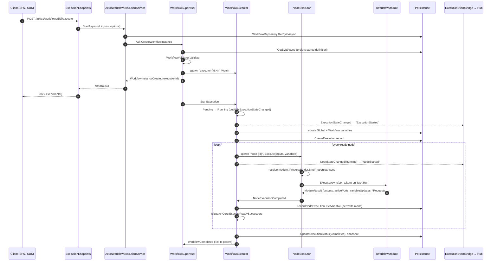
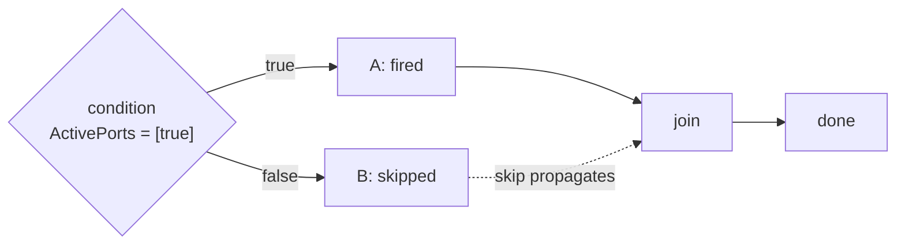
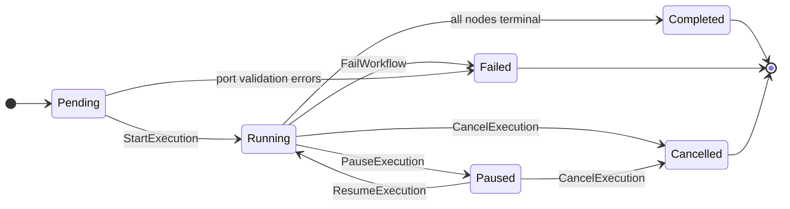
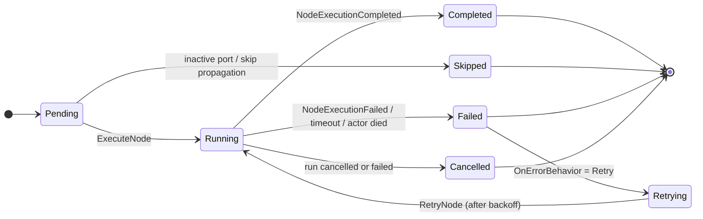
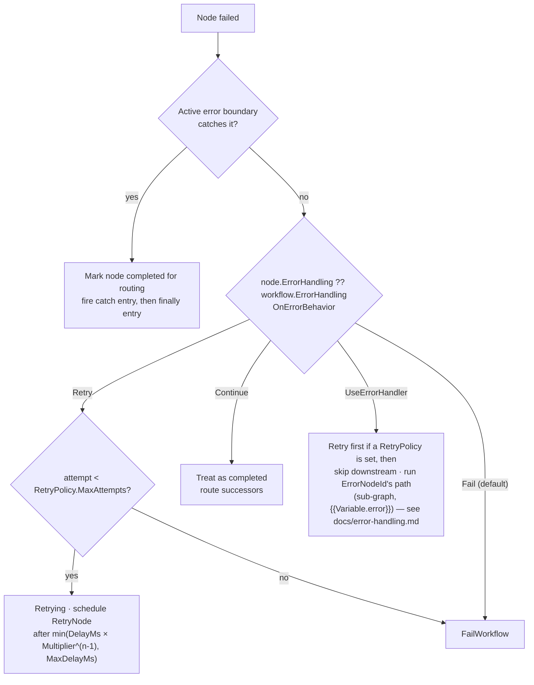

# 01 — Execution lifecycle

> What happens between "Run" and "Completed": every entry point, the actor messages, the state
> machines, error handling, persistence writes and real-time events. Source of truth:
> `Workflow.Engine/Actors/*`, `Workflow.Engine/Messages/*`, `Workflow.Api/Execution/*`,
> `Workflow.Api/Webhooks/*`, `Workflow.Api/RealTime/*` at commit `7b8011e`.
>
> Up: [Architecture overview](00-overview.md) · Related user docs:
> [`../advanced-flow-control.md`](../advanced-flow-control.md), [`../realtime.md`](../realtime.md),
> [`../rest-api.md`](../rest-api.md)

**Contents:** [Entry points](#1-entry-points) · [The happy path](#2-the-happy-path) ·
[Start-up](#3-start-up-inside-the-executor) · [Dispatching a node](#4-dispatching-a-node) ·
[Completion and routing](#5-completion-and-routing) · [State machines](#6-state-machines) ·
[Failure handling](#7-failure-handling) · [Control constructs](#8-control-constructs) ·
[Cancel, pause, resume](#9-cancel-pause-resume) · [Persistence writes](#10-persistence-writes) ·
[Real-time events](#11-real-time-events) · [Findings to verify](#12-findings-to-verify)

---

## 1. Entry points

Every run ends up as a `CreateWorkflowInstance` message to the single `WorkflowSupervisor` actor
(`/user/workflow-supervisor`).

| Entry point | Route / API | Path into the engine | Returns |
| --- | --- | --- | --- |
| Async run | `POST /api/v1/workflows/{id}/execute` | `ExecutionEndpoints` → `IWorkflowExecutionService.StartAsync` → `Ask` supervisor | `202` + `executionId` |
| Sync run | `POST /api/v1/workflows/{id}/execute/sync?timeoutSeconds=` | `StartAndWaitAsync`: start, then poll `GetStatusAsync` with backoff from 50 ms up to 500 ms. Timeout defaults to 30 s, clamped to 1–300 s. | final status, or "timed out" with the last status |
| Run by name | `POST /api/v1/workflows/execute/{name}` | name → id lookup, then as async | `202` |
| Webhook | `POST /webhooks/{webhookId}` (any allowed method) | `WebhookDispatcher` → `ActorWorkflowLauncher` → supervisor | `202 Accepted` (`Async202ResponseStrategy`) |
| Tests / internal | `WorkflowSupervisor.Props(sp)` + `Tell` | direct | — |

The request body can carry `inputs` and `variableWriteMode` (`execution` by default, or `workflow`
or `dual`). These become `ExecutionStartOptions` together with the caller identity. The write mode
decides which variable scopes receive module variable updates (see §10).

`TriggerDefinition` also models `Scheduled` (cron) and `Event` triggers. Nothing in
`Workflow.Api` or `Workflow.Engine` fires them yet (see [§12](#12-findings-to-verify)).

### Webhook path in detail

`WebhookDispatcher.DispatchAsync` does these steps in order:

1. Look up the `WebhookRegistration`.
2. Check the HTTP method is allowed.
3. Buffer the raw body bytes (`EnableBuffering`) *before* anything parses them.
4. Validate the signature if a scheme is configured: `HmacSha256`, `GitHub` or `Stripe`. The HMAC is
   computed over the wire bytes. Failures return `401`, and the reason is only logged, to avoid a
   timing oracle.
5. Parse the body as JSON, or fall back to a raw string.
6. Build the `__webhook__` input payload. `builtin.http.webhook` depends on this key, so it must stay
   stable.
7. Launch through `IWorkflowLauncher`.
8. Hand the response to `IWebhookResponseStrategy`. V1 always answers `202`.

---

## 2. The happy path

Two details matter here:

- The supervisor loads the definition from the repository **again**, and prefers the stored copy
  over the one in the message. The executor always runs the persisted version.
- The executor is told to start right after the reply is sent. The caller gets its `executionId`
  before any node has run.

---

## 3. Start-up inside the executor

`WorkflowExecutor`'s constructor builds the execution graph (`BuildExecutionGraph`):

- successor and predecessor adjacency lists
- in-degree counts
- stream-region detection
- `ValidateConnectionPorts`, which checks each connection's port names against the module schemas

`HandleStartExecution` then runs these steps:

1. **Guard.** Proceed only from `Pending`. Any port-validation error fails the run immediately.
2. **Transition** `Pending → Running`. This publishes `ExecutionStateChanged` and starts the timer.
3. **Hydrate variables** (only if an `IVariableStore` is registered). Load the Global and
   Workflow scopes, then re-resolve `InitialVariables` in this order: declared values, stored layers,
   run inputs. Run inputs win, and `SeedOnly` declarations give way to stored values. A failed load
   is non-fatal and logged, because "store unreachable" and "store empty" look the same from inside
   a workflow.
4. **Create the execution record** via `IExecutionHistoryRepository`. This is also non-fatal: the
   run continues in memory if it fails.
5. **Start the initial nodes**: every node with in-degree 0. If there are none (an empty graph or a
   pure cycle), the run completes immediately.

Steps 3 and 4 are async and come back to the actor as messages through `PipeTo(Self)`
(`VariablesHydrated`, `PersistenceExecutionCreated`), so the actor thread never blocks.

---

## 4. Dispatching a node

`WorkflowExecutor.ExecuteNode(nodeId)` works as follows:

- **Paused?** The node is deferred. Resume re-scans for ready nodes.
- **In a streaming region?** Only the region's source node dispatches, and it starts the whole
  pipeline. Other members return immediately. See [03](03-streaming-and-spill.md).
- **Gather inputs** (`GatherNodeInputs`). A node's input dictionary is the union of:
  - every workflow run input
  - for each incoming connection, `inputs[TargetPort] = sourceOutputs[SourcePort]`
  - every output of every predecessor again, keyed `"{sourceNodeId}.{key}"`
  - `__incomingBranches__` and `__incomingBranchMeta__`: ordered per-connection payloads that
    `builtin.fanin` aggregates, and that every other module ignores

  A skipped predecessor contributes an empty payload, so branch positions stay aligned.
- **Spawn** `NodeExecutor` as child `node-{nodeId}` and watch it. It gets the node definition, the
  inputs and `_executionCts.Token`. It then receives `Execute(nodeId, inputs, executionId,
  variables)`.

Inside `NodeExecutor.HandleExecute`:

| Step | Behaviour |
| --- | --- |
| Cancellation | Creates a CTS linked to the parent token. |
| Timeout | `Context.SetReceiveTimeout(node.Timeout ?? 30000 ms)`. On timeout it cancels the CTS and fails with `TimeoutException`. |
| Module lookup | Uses `IModuleRegistry.GetModule(moduleId[, pinnedVersion])`. A missing *pinned* version fails clearly. A missing *module* falls back to a **stub that succeeds** (see §12). |
| Binding | `PropertyBinder.BindPropertiesAsync(inputs, schema.Inputs, bindingContext)` resolves references, expands opted-in templates, converts types and applies defaults. A binding error fails the node. See [02](02-data-binding-and-variables.md). |
| Execution | Calls `module.ExecuteAsync(ctx, token)` inside `Task.Run`, and pipes the result back as `ExecutionResult`. |
| Result | Success → `SendSuccess(outputs, metrics, variableUpdates, activePorts, loop/parallel/tryCatch/transaction)`. `ModuleResult.Success == false` or an exception → `NodeExecutionFailed`. |

If the module returned a construct request (`LoopRequest`, `ParallelRequest`, `TryCatchRequest` or
`TransactionRequest`), `SendSuccess` first sends the matching `Node*ExecutionRequested` message and
**then** `NodeExecutionCompleted`. Messages from the same sender to the same receiver arrive in
order, so the executor has already stored the request when the completion arrives. That tells it
to spawn a construct actor instead of routing successors.

---

## 5. Completion and routing

`HandleNodeExecutionCompleted` does these steps in order:

1. Transitions the node to `Completed` and records its timing.
2. Applies `VariableUpdates` to the in-memory context, and queues them for persistence according to
   `VariableWriteMode`.
3. Stores the outputs. If the node sets the reserved `outputMode` property to merged,
   `OutputShaping.Merge` collapses all ports into a single `output` port.
4. Queues a `NodeExecutionRecord` with inputs, outputs and duration. It is stamped with
   `LoopId` / `LoopIteration` when a loop scope is active.
5. Stops the node actor.
6. Branches:
   - It is a transaction node → spawn `TransactionExecutorActor`.
   - `IsWorkflowComplete()` → `CompleteWorkflow()`.
   - A loop, parallel or try/catch request is pending → spawn the construct actor. The construct
     later fires the node's `done` port.
   - Otherwise → `DispatchCore.ExecuteReadySuccessors(nodeId, activePorts)`.

### DispatchCore routing rules

`DispatchCore` (shared by `WorkflowExecutor` and `SubGraphExecutor`) has two modes:

- **`ActivePorts` empty (legacy "fire-all").** Every successor is tried.
- **`ActivePorts` set (port-aware).** Targets connected through an active port are *fired*. Targets
  reached only through inactive ports are *skipped*, and the skip propagates downstream.

It also applies two rules:

- **Fire rule.** A node runs when it is not already running or terminal, and **every** predecessor
  is `Completed` or `Skipped`. This makes a join wait for all its inputs.
- **Skip rule.** A node is skipped when **every** predecessor is `Completed`, `Failed` or
  `Skipped`. The skip then recurses to its successors.

After a skip propagates, the owner checks for completion. A run is complete when:

- no node is running
- no loop, parallel, try/catch or transaction is pending
- `completed + failed + skipped ≥ node count`

Workflow outputs are gathered from **end nodes** (no successors) as `"{nodeId}.{port}"`.

---

## 6. State machines

Every transition goes through `TransitionExecutionState` / `TransitionNodeState`. These update
`WorkflowExecutionContext` and publish `ExecutionStateChanged` / `NodeStateChanged` on the Akka
`EventStream`.

---

## 7. Failure handling

When a node fails, `HandleNodeFailure` records it (state, `NodeExecutionRecord` with the error),
stops the actor, and then decides what to do:

- **Error boundaries come first.** A node inside a try block goes straight to the catch handler,
  even if it has a retry policy.
- **`RetryPolicy.MaxAttempts` counts total executions.** The default is `RetryPolicy.Default`
  (3 attempts, 1 s base delay, ×2 backoff, 60 s cap). That gives: run → fail → wait 1 s → run →
  fail → wait 2 s → run → fail → workflow fails.
- **The backoff is an Akka scheduler message** (`ScheduleTellOnceCancelable`), not a sleep. The
  handle is kept in `_pendingRetryCancellations`.
- **`NodeRetrying` is published on the EventStream.** The bridge doesn't forward it to SignalR
  yet.
- **`FailWorkflow`** does four things: cancels `_executionCts`, stops the running node actors
  (marking them `Cancelled`), writes status and a snapshot, and tells the parent `WorkflowFailed`
  with any partial outputs.

### Supervision

`WorkflowSupervisor` uses `OneForOneStrategy(maxNrOfRetries: 3, within: 1 min)` for its executors:

| Exception | Directive |
| --- | --- |
| `TimeoutException`, `IOException` | Restart |
| `InvalidOperationException`, `ArgumentException` | Stop |
| anything else | Escalate |

Each decision is published as a `SupervisionEvent`. When the supervisor itself restarts, it doesn't
stop its children (`PreRestart` is overridden). `PostRestart` rebuilds `activeWorkflows` from the
children's `executor-{guid:N}` names.

---

## 8. Control constructs

A construct is an ordinary module whose `ModuleResult` carries a request. The executor turns the
request into a child actor. That actor runs one or more `SubGraphExecutor`s over the nodes reachable
from the construct's body port(s), then fires the construct's `done` / result port on the parent
graph.

| Module(s) | Request (Workflow.Core) | Actor | Key options | Ports |
| --- | --- | --- | --- | --- |
| `builtin.loop.foreach`, `builtin.loop.while` (+ `break`, `continue`) | `LoopRequest` | `LoopExecutorActor` | `Items` or `ContinueCondition`, `MaxIterations` (1000), `ContinueOnError` | `loopBody`, `done` |
| `builtin.parallel`, `builtin.fanout`, `builtin.partition` | `ParallelRequest` | `ParallelExecutionCoordinator` | `BranchPorts` or `Items`, `MaxDegreeOfParallelism`, `FailFast`, `WaitForAll` | branch ports, `done` |
| `builtin.trycatch` (+ `throw`) | `TryCatchRequest` | `TryCatchExecutorActor` | `Rethrow` | `try`, `catch`, `finally`, `done` |
| `builtin.database.transaction` | `TransactionRequest` | `TransactionExecutorActor` | connection, provider, isolation, timeout | `transactionBody`, `committed`, `rolledBack` |

- **Body scope.** `LoopExecutorActor.ComputeBodyScope` (and its equivalents) collects the nodes
  reachable from the body port. The parent never dispatches those nodes itself. When the construct
  fires only its `done` port, the body entries fall on an inactive port and the parent marks them
  skipped.
- **Each body run** is a `SubGraphExecutor`. It uses `DispatchCore` for port routing, persists its
  nodes' records, and replies `SubGraphCompleted` or `SubGraphFailed`.
- **Scopes.** Loop actors send `PushLoopScope` / `PopLoopScope` so node records carry iteration
  metadata. Try/catch sends `PushErrorBoundary` / `PopErrorBoundary` so the parent's
  `TryHandleWithBoundary` can route failures.
- **Cancellation.** Every construct and sub-graph links its CTS to the parent's token. Cancelling
  `_executionCts` cascades all the way down. There are also `CooperativeCancel*` messages for
  `break` and for fail-fast parallel.

---

## 9. Cancel, pause, resume

**Cancel** (`POST /api/v1/executions/{id}/cancel`):

1. `CancelAsync` checks the execution exists.
2. It sends a fire-and-forget `CancelExecution` through the supervisor.
3. The executor stops every actor in `_nodeActors`, marks those nodes `Cancelled`, and moves to
   `Cancelled`.
4. It writes status and a snapshot, and tells the parent `WorkflowFailed(OperationCanceledException)`.

**Pause** sets `_isPaused` and moves to `Paused`. Nodes that are already running finish. New
dispatches are deferred. A snapshot is saved.

**Resume** moves back to `Running` and re-scans all nodes. Any node whose predecessors are all
completed or skipped is dispatched.

There is no REST endpoint for pause or resume yet. The messages exist on the actor protocol only.

---

## 10. Persistence writes

All writes are queued from the actor through `Task.Run(...).PipeTo(Self)`, and every failure is
logged and tolerated. The engine keeps going if the store is down.

| When | Method | Store call |
| --- | --- | --- |
| Run starts | `QueueCreateExecutionRecord` | `IExecutionHistoryRepository` create execution |
| Node completes or fails | `QueueRecordNodeExecution` | node record (inputs, outputs or error, duration, loop metadata) |
| Node emits variable updates | `QueuePersistVariableUpdates` | `IVariableStore.SetVariableAsync` in the `Execution` scope, the `Workflow` scope, or both (`VariableWriteMode`) |
| State changes to terminal | `QueueUpdateExecutionStatus` | execution status, end time, error |
| Pause, cancel, complete, fail | `SaveSnapshotAsync` | `IExecutionStateStore.SaveSnapshotAsync`. Always `InMemoryExecutionStateStore` today. |
| Inside sub-graphs | `SubGraphExecutor.QueuePersistNode` | node records for body nodes |

---

## 11. Real-time events

`ExecutionEventBridge` (an `IHostedService` in the API) subscribes an `EventForwarder` actor to the
`EventStream` for seven message types. The forwarder writes into an unbounded `Channel`. A consumer
task resolves the workflow id (cached, falling back to execution history) and broadcasts to the
SignalR groups `execution:{id}`, `workflow:{id}` and `all`.

| Engine message | Published to EventStream by the engine? | SignalR client method |
| --- | :-: | --- |
| `ExecutionStateChanged` (Pending → Running) | yes, `TransitionExecutionState` | `ExecutionStarted` |
| `NodeStateChanged` (→ Running) | yes, `TransitionNodeState` | `NodeStarted` |
| `WorkflowCompleted` | **no**, only `Tell`'d to the supervisor | `ExecutionCompleted` |
| `WorkflowFailed` | **no**, only `Tell`'d to the supervisor | `ExecutionFailed` |
| `NodeExecutionCompleted` | **no**, sent by the node to its parent | `NodeCompleted` |
| `NodeExecutionFailed` | **no**, sent by the node to its parent | `NodeFailed` |
| `ProgressUpdate` | **no**, only a reply to `GetProgress` | `ExecutionProgress` |
| `NodeRetrying`, `StreamRegionProgress`, `SupervisionEvent` | yes | not forwarded |

On `SubscribeToExecution`, the hub also sends an `ExecutionSnapshot` of the current state.

---

## 12. Findings to verify

These came from reading the code, not from running it. Each deserves a failing test before it
gets a fix.

1. **Terminal and node-completion events don't reach SignalR.**
   - What the code does: only state-change events are published to the `EventStream` (§11). The
     bridge tests pass because they publish `WorkflowCompleted` etc. by hand.
   - Likely effect: with a live hub connection, the designer overlay never hears
     `ExecutionCompleted`, `ExecutionFailed`, `NodeCompleted` or `NodeFailed`. Its polling fallback
     only starts if the subscription itself throws.
   - Candidate fix: map terminal `ExecutionStateChanged` / `NodeStateChanged` transitions in the
     bridge, or publish the terminal messages from the executor.
2. **Executor actors are never stopped.**
   - What the code does: `WorkflowExecutor` has no `Context.Stop(Self)` or receive timeout. The
     supervisor has no handler for `WorkflowCompleted` / `WorkflowFailed`.
   - Likely effect: `activeWorkflows` and the actor tree grow with every run, and each executor
     keeps its full inputs and outputs in memory. Status queries for old runs keep hitting live
     actors, not history.
3. **Cancel doesn't cancel `_executionCts`.**
   - What the code does: `HandleCancelExecution` stops `_nodeActors` but not construct actors, and
     doesn't call `_executionCts.Cancel()`. `CompleteWorkflow` and `FailWorkflow` both do.
   - Likely effect: a running loop or parallel block keeps iterating after a user cancels. Pending
     retry timers also stay armed.
4. **Sub-graphs ignore per-node error handling and nested constructs.**
   - What the code does: `SubGraphExecutor` only receives `NodeExecutionCompleted` / `Failed` /
     `Terminated`, and any failure fails the sub-graph.
   - Likely effect: `Retry` and `Continue` on a node inside a loop body or branch are ignored. A
     loop, try/catch, parallel or transaction node *inside* a body sends its request to the
     sub-graph, which drops it, so the construct degrades to a plain node that fires its ports
     once. Stream regions aren't detected inside bodies either.
5. **A missing module "succeeds".**
   - What the code does: `NodeExecutor.ExecuteStubFallback` returns a fake success when a module id
     isn't registered (for example, a plugin was uninstalled). `ValidateConnectionPorts` also skips
     unregistered modules, with the comment "runtime execution will catch this". It doesn't.
   - Likely effect: a workflow can complete while doing nothing. This fallback was meant for tests.
     Production should fail the node, or the validator should reject unknown module ids up front.
6. ~~**A join can be skipped when it has a live input.**~~ **Fixed (Stage 7.2):** `DispatchCore`
   remembers nodes a predecessor has activated and fires them instead of skipping them, for
   conditional edges and module ports alike. Guarded by
   `ConditionalEdgeTests.PortRouting_AJoinDeactivatedByTheLastPredecessor_StillRuns`. Original
   note:
   - What the code does: the skip rule treats `Completed` predecessors as settled.
   - Likely effect: take a join with one input from an independent path that already completed,
     and another from a branch deactivated *later*. The join is skipped instead of fired. The
     common "branch then merge" shape is unaffected, because both inputs come after the same
     condition.
7. ~~**`UseErrorHandler` isn't implemented.**~~ **Fixed (§12.7):** a catch-style handler, with
   retries first, the failed node's downstream skipped and the handler's path continuing. Handler
   nodes don't start on their own, and `MaxConsecutiveErrors` is honoured. See
   [error handling](../error-handling.md).
8. **Scheduled and Event triggers have no runtime.** No cron scheduler or event subscription exists
   in the host.
