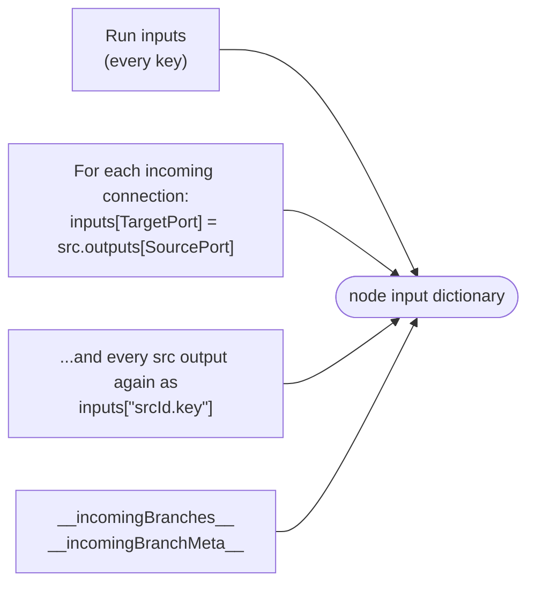
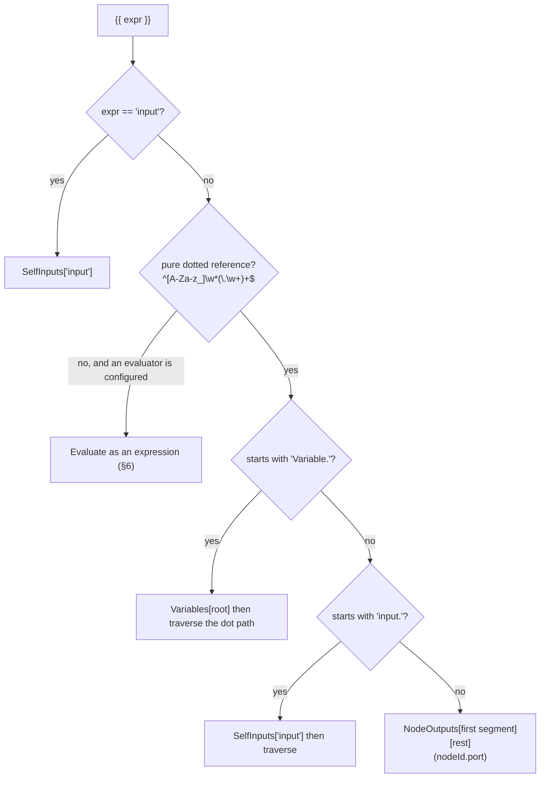

# 02 — Data binding & variables

> How a value gets from one node into the next module's `ExecuteAsync`. Covers port routing, the
> `{{…}}` template language, the expression evaluators, output shaping, and where variables come
> from and go to. Source of truth: `Workflow.Modules/Binding/PropertyBinder.cs`,
> `Workflow.Engine/Actors/{WorkflowExecutor,SubGraphExecutor,NodeExecutor}.cs`,
> `Workflow.Engine/Models/InitialVariables.cs`, `Workflow.Engine/Services/*Evaluator*.cs` at commit
> `7b8011e`.
>
> Up: [Architecture overview](00-overview.md) · The user-facing guide is
> [`../variables.md`](../variables.md). This page explains the machinery behind it.

**Contents:** [Two channels](#1-two-channels-ports-and-properties) ·
[Building a node's inputs](#2-building-a-nodes-inputs) ·
[The binding context](#3-the-binding-context) · [PropertyBinder](#4-propertybinder) ·
[Template grammar](#5-template-grammar) · [Expressions](#6-expressions) ·
[Output shaping](#7-output-shaping) · [Variables](#8-variables-sources-precedence-writes) ·
[Inside constructs](#9-inside-loops-branches-and-try-blocks) ·
[Findings to verify](#10-findings-to-verify)

---

## 1. Two channels: ports and properties

A module's `ModuleSchema` declares two kinds of value:

| | **Input ports** (`PortDefinition`) | **Properties** (`ModulePropertyDefinition`) |
| --- | --- | --- |
| Carries | Runtime data from upstream nodes or run inputs | Configuration the author typed in the designer |
| Stored in | Nothing: gathered fresh per run | `NodeDefinition.Properties` (`HashMap<string, JsonElement>`) |
| Bound by | `PropertyBinder.BindPropertiesAsync` | `PropertyBinder.BindModulePropertiesAsync` |
| Template expansion | Only if `SupportsTemplates = true` (default **false**) | Only if `SupportsTemplates = true` (default **false**) |
| Type conversion | Yes, to `PortDefinition.DataType` | No, passed as converted JSON |
| Missing value | Default, or an error if `IsRequired` (default **true**) | Passed through as absent |
| Reaches the module as | `ModuleExecutionContext.Inputs` | `ModuleExecutionContext.Properties` |

Template expansion is opt-in on both channels, and this is a security boundary.

- **Ports:** a port's value comes from upstream data, which may be untrusted. If it contains
  `{{Variable.apiKey}}`, that text must not expand into your secret.
- **Properties:** SQL text, script bodies and connection strings must reach the module exactly as
  authored. SQL *parameter values* opt in, and are then bound as parameters, never concatenated
  into the SQL.

---

## 2. Building a node's inputs

`WorkflowExecutor.GatherNodeInputs(nodeId)` builds one flat dictionary. Later writes win:



- **Only direct predecessors contribute.** The dictionary holds outputs from nodes wired into this
  node, and nothing from further upstream.
- **A skipped predecessor contributes an empty payload.** This keeps `__incomingBranches__`
  positions aligned for `builtin.fanin`.
- **The executor captures the dictionary per node.** It is persisted as the node record's `Inputs`,
  so run inputs appear in every node's history row.

---

## 3. The binding context

`NodeExecutor.BuildBindingContext()` turns that dictionary, plus the execution's variables, into a
`PropertyBindingContext`:

```text
Variables    = execution variables (from Execute.Variables)
               then, for every *plain* input key (no dot):  Variables[key] = inputs[key]   ← overlay
NodeOutputs  = for every "srcId.key" input:  NodeOutputs[srcId][key] = value
SelfInputs   = the whole input dictionary   (powers {{input}} / {{input.path}})
```

The plain-key overlay is a compatibility shim from before Phase 3.5. At that time, run inputs were
the *only* variables. The overlay has two consequences:

- A run input `orderId` is reachable as `{{Variable.orderId}}`.
- An input *port* named `count` shadows a real variable `count` for that node (see §10).

---

## 4. PropertyBinder

### Ports: `BindPropertiesAsync(rawValues, schema.Inputs, context)`

For each declared port, the binder runs these steps and accumulates every error (it never stops at
the first):

1. **Look up** the raw value: exact key first, then case-insensitive.
2. **Missing or null?** Use `DefaultValue`, otherwise record an error if `IsRequired`, otherwise
   `null`.
3. **Resolve templates**, only if `SupportsTemplates` is set and the value is a string.
4. **Convert** to `DataType`. Strings, `JsonElement`s and numeric widening are handled in
   `ConvertToExpectedType`.
5. **Type check** that the result is an instance of `DataType` (skipped when `DataType` is
   `object`).

After that loop, input keys that aren't in the schema **pass through untouched**. That is how
`srcId.key`, `__incomingBranches__` and the rest reach modules that know to look for them.

### Properties: `BindModulePropertiesAsync(rawValues, schema.Properties, context)`

Only string values whose property name is template-enabled get resolved. The name comparison is
case-insensitive. Everything else passes through verbatim.

Any error from either method fails the node before `ExecuteAsync` runs, with the message
`Input binding failed: …` or `Property binding failed: …`.

---

## 5. Template grammar

The reference pattern is `(?<!\\)\{\{\s*(.+?)\s*\}\}`. Write `\{\{` for a literal `{{`. The binder
un-escapes it after resolution.

The binder resolves each `{{ expr }}` in this order:



| Form | Example | Resolves against |
| --- | --- | --- |
| Self input | `{{input}}`, `{{input.customer.id}}` | this node's `input` port value. `input` is a reserved root and beats a node named `input`. |
| Variable | `{{Variable.apiBaseUrl}}`, `{{Variable.user.name}}` | the context's `Variables`. Root lookup is case-insensitive. |
| Node output | `{{fetch.response}}`, `{{fetch.response.items}}` | the context's `NodeOutputs`, i.e. **direct predecessors only** |
| Expression | `{{Variable.count > 5}}`, `{{input.total * 1.2}}` | the default `IExpressionEvaluator` |

- **A whole-string reference keeps its type.** `"{{fetch.response}}"` yields the object itself.
- **Mixed text is interpolated as a string.** `"Order {{input.id}} for {{Variable.tenant}}"`
  becomes one string.
- **An unresolvable reference fails the node.** It never passes through as literal text.
- **Traversal** (`TraverseProperty`) walks dictionaries, `JsonElement` objects and public
  properties. There is no list indexing: `{{input.items.0}}` quietly yields `null`.

---

## 6. Expressions

A template that isn't a pure reference is evaluated as an expression:

1. The binder scans for dotted tokens (`ReferenceTokenPattern`) and tries to resolve each one as a
   reference.
2. Each token that resolves is replaced by a safe identifier (`Variable.count` →
   `__ref_Variable_count`) and put in the evaluator's scope. Tokens that don't resolve (`Math.max`,
   `JSON.parse`) are left for the evaluator to handle.
3. The rewritten expression is evaluated. The binder waits for the result synchronously (see §10).

| Evaluator | Registered as | Engine | Guards | Used by |
| --- | --- | --- | --- | --- |
| `JintExpressionEvaluator` | default `IExpressionEvaluator` | Jint (ES) | strict mode, memory limit, `TimeoutInterval`, recursion limit, cancellation | `PropertyBinder`, `builtin.condition`, `builtin.loop.while`, transform item expressions |
| `DynamicExpressoEvaluator` | keyed `"csharp"` | DynamicExpresso | C# expression subset, no statements | transform modules with `language: "csharp"` (`ItemExpressionEvaluator`) |
| `KeyedExpressionEvaluatorFactory` | `IExpressionEvaluatorFactory` | — | picks by key | transform modules |

`ConnectionDefinition.Condition` and `Priority` decide which edges fire (Stage 7.2, see
[conditional edges](../conditional-edges.md)): `EdgeRouting` evaluates conditions through
`PropertyBinder.EvaluateConditionAsync`, with `value` set to the edge's value. Priority ≥ 1 makes the
edges leaving one port an if / else-if / else chain. The executors evaluate conditions in a task and
route when the result comes back, so a slow condition doesn't block them. Branching can also be done with
`builtin.condition` or `builtin.switch` plus `ActivePorts`, which are checked first.

---

## 7. Output shaping

A module returns `ModuleResult.Outputs`, a dictionary with one entry per output port. The executor
then does the following:

- If the node's reserved `outputMode` property is `"merged"`, the outputs are wrapped as
  `{ "output": { …all ports… } }` (`OutputShaping.Merge`). Downstream connections must then use
  port `output`. `ValidateConnectionPorts` allows that one port.
- The shaped outputs go into `_nodeOutputs[nodeId]`. That dictionary is the only thing successors
  can see.
- Workflow-level outputs are gathered from end nodes as `"{nodeId}.{port}"`.
- `ModuleResult.ActivePorts` selects which outgoing connections fire (see
  [01 §5](01-execution-lifecycle.md#5-completion-and-routing)).

---

## 8. Variables: sources, precedence, writes

### Scopes and storage

`IVariableStore` (from the persistence provider) keeps versioned values per `VariableScope`:

| Scope | Key | Written by | Read at run start? |
| --- | --- | --- | --- |
| Global | `VariableScope.Global` | Settings UI, `PUT /api/v1/variables/{name}?scope=global` (Admin) | yes |
| Workflow | `VariableScope.ForWorkflow(workflowId)` | runs with write mode `workflow` or `dual`, the API | yes |
| Execution | `VariableScope.ForExecution(executionId)` | runs with write mode `execution` (default) or `dual` | no. It is a record of what the run wrote. |

### Precedence at start

`InitialVariables.Resolve` is pure, so it can be unit-tested on its own. It layers values lowest
first:


- A declared type that doesn't match the initial value produces a warning. The value is used
  anyway.
- If no store is registered, only layers 3–5 apply.
- The resolved map becomes `WorkflowExecutionContext.Variables`. Each `NodeExecutor` receives it in
  the `Execute` message.

### Writes during a run

1. A module returns `ModuleResult.VariableUpdates`. `builtin.setvariable` is the usual source.
2. `NodeExecutor` forwards them in `NodeExecutionCompleted.VariableUpdates`.
3. `WorkflowExecutor` applies them to the context immediately, so later nodes see them.
4. `QueuePersistVariableUpdates` then writes each one to the Execution scope, the Workflow scope,
   or both, according to `ExecutionStartOptions.VariableWriteMode`.

### Secrets

`VariableDefinition.IsSecret` is read only by the designer (masking in the Variables panel and Run
dialog). No server code reads it. The user guide says this too (see
[`../variables.md#secrets--current-limits`](../variables.md#secrets--current-limits)).

---

## 9. Inside loops, branches and try blocks

Nodes inside a construct body run under a `SubGraphExecutor`, and their inputs are built
differently:

| | Top-level node | Node inside a body |
| --- | --- | --- |
| Base dictionary | run inputs | the construct's context snapshot: run inputs + variables at spawn time, plus `item` / `index` for foreach |
| `Execute.Variables` | the live context variables | **empty**. Variables are only reachable through the plain-key overlay of that snapshot. |
| Variable writes | applied and persisted | **ignored**. `SubGraphExecutor` never reads `VariableUpdates`. |
| Carrying state between iterations | — | the loop merges each iteration's terminal outputs (`"node.key"`) back into its context |

---

## 10. Findings to verify

These came from reading the code. Each needs a failing test before a fix.

1. **`{{nodeId.port}}` only reaches direct predecessors.**
   - What the code does: `NodeOutputs` is built from the `srcId.key` keys, and only wired
     predecessors put those keys in the dictionary.
   - Conflict: [`../variables.md`](../variables.md) says it is "the only way to reach nodes
     further upstream".
   - Fix options: either give the binder a read-only view of all `_nodeOutputs`, or correct the
     docs and the designer's picker.
2. **Input keys shadow variables.**
   - What the code does: every plain input key (run inputs *and* mapped port values) is copied over
     `Variables`.
   - Likely effect: a port named `count` or `result` changes what `{{Variable.count}}` means for
     that node only. The overlay should probably apply only where no real variable exists, or only
     to run inputs.
3. **Variables inside construct bodies are a snapshot, and writes are dropped** (§9).
   - Likely effect: a `SetVariable` in a foreach body never updates the workflow. A body node reads
     the values from when the loop started. Accumulating a counter in a loop doesn't work through
     variables.
4. ~~**`ConnectionDefinition.Condition` and `Priority` are dead fields.**~~ **Fixed (Stage 7.2):**
   conditional edges and priority chains. See [conditional edges](../conditional-edges.md).
5. ~~**Expression evaluation blocks the actor.**~~ **Fixed (Stage 7.9):** `NodeExecutor` gathers
   the binding inputs on the actor thread (cheap). It then binds inputs and properties inside the
   node's execution task, just before the module runs. The effects:
   - no dispatcher thread is held;
   - the node's timeout covers binding;
   - a cancel sent during binding is handled at once, so the module never starts;
   - a result arriving after a timeout or cancel is dropped, so there is no second report.
   Binding failures keep their messages ("Input binding failed: …" / "Property binding failed: …").

   **Async binding (follow-up, 2026-11-09):** `IPropertyBinder` is async (`BindPropertiesAsync`,
   `BindModulePropertiesAsync`, `EvaluateConditionAsync`); the binder awaits the evaluator and no
   longer waits on it. Edge conditions (Stage 7.2) are no longer evaluated on the *executor's*
   thread: `EdgeRouting.DecideInBackground` runs them in a task and pipes `EdgesDecided` back, and
   the node completes (or fails) when that arrives. `StreamRegionExecutor` binds its stages'
   properties in its run task too. These callers start binding with `Task.Run` rather than relying
   on `await`: an evaluator or binder may finish synchronously (DynamicExpresso does; Jint offloads
   to the pool itself).
6. **Secrets reach history in plain text.** Run inputs are copied into every node's input
   dictionary, and that dictionary is persisted as `NodeExecutionRecord.Inputs`. Variable updates
   are also logged with their values at debug level.
