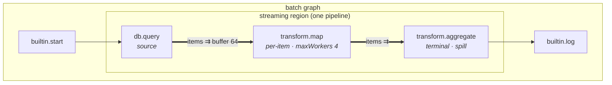
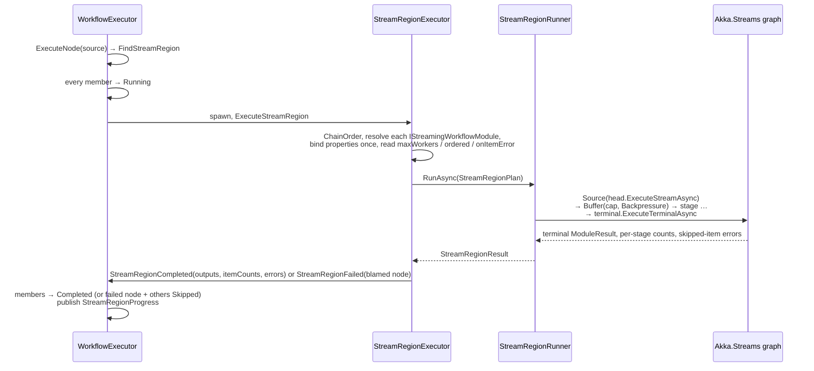
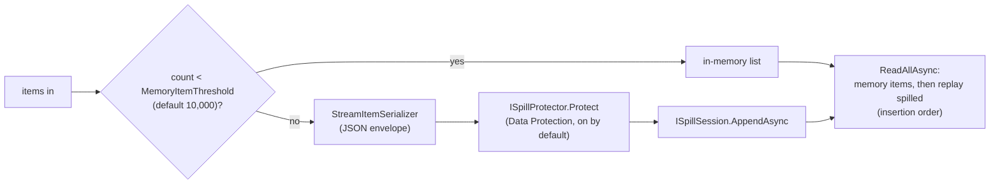

# 03 — Streaming & spill

> How DotFlow runs part of a workflow as a back-pressured item stream instead of passing one value
> per node. Covers the module contracts, how regions are detected, the Akka.Streams runner, the
> memory policy, and spill-to-disk. Source of truth: `Workflow.Core/Models/StreamItem.cs`,
> `Workflow.Modules/Abstractions/IStreamingWorkflowModule.cs`, `Workflow.Modules/Streaming/*`,
> `Workflow.Engine/Streaming/*`, `Workflow.Engine/Actors/StreamRegionExecutor.cs`,
> `Workflow.Api/Streaming/*` at commit `7b8011e`.
>
> Up: [Architecture overview](00-overview.md) · Design history:
> [`../../phases/Phase5-1-StreamingDataPlane.md`](../../phases/Phase5-1-StreamingDataPlane.md),
> [`../../phases/Phase5-1-6-SpillMode-Plan.md`](../../phases/Phase5-1-6-SpillMode-Plan.md),
> [`../../new-feature-design/snaplogic-analysis/06-streaming-data-plane-design.md`](../../new-feature-design/snaplogic-analysis/06-streaming-data-plane-design.md)

**Contents:** [The model](#1-the-model-in-one-picture) · [Contracts](#2-contracts) ·
[Region detection](#3-region-detection) · [Running a region](#4-running-a-region) ·
[Per-item errors](#5-per-item-errors) · [Memory policy and spill](#6-memory-policy-and-spill) ·
[Spill stores and cleanup](#7-spill-stores-and-cleanup) · [Status](#8-status) ·
[Findings to verify](#9-findings-to-verify)

---

## 1. The model in one picture

Batch execution is still the default: one run, one traversal, one value per port. Streaming is
**opt-in per connection**:

- An edge is streaming only when **both** of its ports are declared streaming
  (`PortDefinition.CreateStreaming`).
- A maximal connected group of streaming edges forms a **region**.
- A region runs as a single Akka.Streams pipeline inside the ordinary batch run.



The region's **source** receives the batch inputs gathered for it. Its **terminal** returns a normal
`ModuleResult`, which feeds non-streaming successors as usual. To the batch graph, the whole region
looks like one very long node.

---

## 2. Contracts

### Items

```csharp
record StreamItem(StreamPayload Payload, long Index = 0, SourceOffset? Offset = null);
abstract record StreamPayload;            // JsonPayload(JsonElement) | EmptyPayload
record SourceOffset(string Token, long Sequence);   // where the item came from, for errors & resume
```

### Module shapes

Every streaming module also implements `IWorkflowModule`, so it still works in batch mode. It then
picks one of three streaming shapes:

| Interface | Who owns the loop | Concurrency | Role | Built-in implementations |
| --- | --- | --- | --- | --- |
| `IStreamingWorkflowModule.ExecuteStreamAsync(ctx, IAsyncEnumerable<StreamItem> input, ct)` | the module | always 1 | source (ignores `input`) or whole-stream transform | `file.csv.read`, `file.json.read`, `database.query`, `stream.fromitems` |
| `IStreamItemProcessor.ProcessAsync(item, ctx, ct)` → 0..N items | the engine | `maxWorkers`, order kept by default | per-item map, filter or split | `transform.map`, `transform.query` |
| `IStreamTerminalModule.ExecuteTerminalAsync(ctx, input, ct)` → `ModuleResult` | the module | 1 | sink or accumulator | `stream.collect`, `transform.aggregate`, `file.csv.write`, `file.json.write`, `database.bulkinsert` |

- **Prefer `IStreamItemProcessor` for per-item work.** It is the only shape the engine can
  parallelise.
- **Bridges.** `builtin.stream.fromitems` turns a batch array into a stream, and
  `builtin.stream.collect` turns a stream back into a batch array.
- **Variables inside a region are read-only.** Stage contexts get a snapshot taken when the region
  starts, and variable writes are forbidden.

---

## 3. Region detection

`StreamRegionDetector.Regions(definition, schemaOf)`:

1. Keeps only the edges where `IsStreamingPort(source, output)` and
   `IsStreamingPort(target, input)` are both true.
2. Finds the connected components of those edges, treating them as undirected. It walks nodes in
   definition order, so region indices are stable from run to run.
3. Returns a `StreamRegion(Index, NodeIds, Edges)` per component. `SourceNodeIds` are members with
   no incoming streaming edge. `TerminalNodeIds` are members with no outgoing one.

Detection uses **connections and schemas only**. `NodeDefinition.RegionId` is a designer hint that
the engine never reads, so an imported or hand-edited definition can't disagree with what runs. The
designer has its own copy of this logic (`Workflow.UI.Client/Designer/State/StreamGraph.cs`). A
drift-guard test keeps the two in sync.

**v1 regions are linear chains.** `ChainOrder()` throws if a region has more than one source, or if
any node has more than one outgoing streaming edge. Fan-out and merge inside a region are
deliberately unsupported for now.

---

## 4. Running a region



### Stage assembly (`StreamRegionRunner.RunAsync`)

| Piece | Built as |
| --- | --- |
| Head (source) | `Source.From(() => head.ExecuteStreamAsync(ctx, empty, ct))` |
| Between stages | `.Buffer(capacity, OverflowStrategy.Backpressure)`. Capacity is the incoming connection's `BufferCapacity`, else **64** (`DefaultBufferCapacity`). |
| Per-item stage | `SelectAsync(maxWorkers, ProcessAsync)` when `ordered` (the default), otherwise `SelectAsyncUnordered`, then `SelectMany` |
| Whole-stream stage | `Source.From(() => module.ExecuteStreamAsync(ctx, upstream.RunAsAsyncEnumerable(mat), ct))` |
| Terminal | `ExecuteTerminalAsync(ctx, upstream.RunAsAsyncEnumerable(mat), ct)`. With no terminal, the pipeline drains into `Sink.Ignore`. |

Ordering costs almost nothing: `SelectAsync` emits results by input slot. A call that returns zero
items contributes nothing at its slot, and a call that returns many keeps them together. That is
why the resequencing buffer from the original design was deleted (decision D25).

### Stage knobs (node properties, read by `StreamRegionExecutor`)

| Property | Default | Applies to | Effect |
| --- | --- | --- | --- |
| `maxWorkers` | 1 | `IStreamItemProcessor` only. Pinned to 1, with a warning, for other shapes. | concurrent `ProcessAsync` calls |
| `ordered` | `true` | per-item stages | keep source order across workers |
| `onItemError` | `fail` | per-item stages | `skip` drops the failing item and records it (see §5) |
| connection `BufferCapacity` | 64 | the edge into a stage | items allowed to wait upstream |

### Contexts

Properties are bound **once per region**, with `BindModuleProperties` and the same template rules
as batch nodes. **Only the source** sees the gathered graph inputs. Later stages read the stream.
`Variables` is the snapshot taken when the region starts.

---

## 5. Per-item errors

- **`onItemError: fail` (the default).** The first exception fails the whole region.
  `StreamRegionFailed` blames the stage that threw, or the source when that can't be determined.
  The executor calls `HandleNodeFailure` on the blamed node and marks the other members `Skipped`,
  so the node's normal error handling applies.
- **`onItemError: skip`.** The item is dropped and a `StreamItemError(nodeId, index, offset,
  exception)` is recorded. On completion, each stage's skipped items become that node's `errors`
  output. The documents follow the per-item error shape from design doc 07 (`item` / `offset`
  fields), so they can be wired to a logger or a dead-letter branch.
- **A terminal that returns a failed `ModuleResult`** (for example, the collect guard tripping) is
  treated as a node failure.

---

## 6. Memory policy and spill

Streaming promises bounded memory. Stages that must hold items (`stream.collect`,
`transform.aggregate`) therefore go through one shared policy, `BoundedAccumulator`:

| Property | Default | Meaning |
| --- | --- | --- |
| `maxItems` | 100,000 (`BoundedAccumulator.DefaultMaxItems`, a placeholder until calibration) | hard ceiling on items held |
| `maxBytes` | none | optional ceiling on payload bytes |
| `spill` | `false` | past the memory budget, write items to the spill store instead of holding them. **The ceilings still apply.** |

When `spill` is on, the stage uses a `SpillableItemBuffer`, which keeps a memory head and a spilled
tail:



- **`ISpillSession` is append-then-replay only.** It is keyed by
  `SpillSessionKey(ExecutionId, RegionIndex, NodeId)`. With no random access, every store stays
  simple.
- **Disposing the session deletes its data.** That covers the normal path. The sweeper in §7 covers
  crashes.
- **Asking for spill without a store fails loudly.** If `spill: true` is set but the host has no
  store configured, the node fails with a message naming `Streaming:Spill:Store`. There is no
  silent default location.

---

## 7. Spill stores and cleanup

Spill is configured under `Streaming:Spill` (`SpillOptions`). `AddStreamingSpill` registers an
`ISpillStore` **only** when a store is configured.

| `Store` | Implementation | Required setting | Notes |
| --- | --- | --- | --- |
| `None` (default) | none registered | — | `spill: true` fails the node |
| `Sqlite` | `SqliteSpillStore` | `SqlitePath` | recommended local option |
| `Blob` | `BlobStoreSpillStore` | a persistence provider with an `IBlobStore` | Postgres, NATS (or S3 when it's wired); for hosts with little local disk |
| `Directory` | `DirectorySpillStore` | `DirectoryPath` | explicit opt-in |

| Setting | Default | Purpose |
| --- | --- | --- |
| `Encrypt` | `true` | `DataProtectionSpillProtector`. Turning it off logs a warning at startup. |
| `MemoryItemThreshold` | 10,000 | memory head size for `SpillableItemBuffer` |
| `RetentionAfterCompletion` | 1 h | how long to keep spill after the execution is terminal |
| `AbandonedThreshold` | 2 days | a non-terminal execution this stale is treated as crashed |
| `SweepInterval` | 15 min | how often `SpillCleanupHostedService` runs |

`SpillCleanupHostedService` runs a `PeriodicTimer`. On each tick it lists the execution ids that
hold spill, looks each one up in execution history, and decides:

- **Delete (completed):** the execution is terminal and past `RetentionAfterCompletion`.
- **Delete (abandoned):** the execution is non-terminal and not updated for `AbandonedThreshold`.
- **Keep:** anything else. This includes every execution when no history repository is registered.

---

## 8. Status

From `phases/Phase5-1-StreamingDataPlane.md` and the code:

| Slice | State |
| --- | --- |
| 5.1.0 contracts · 5.1.1 bridges · 5.1.2 designer (diamond ports, region halos, drag-time refusal) | done |
| 5.1.3 region executor · 5.1.4 workers, per-item errors, module coverage | done |
| 5.1.6 spill (SQLite, blob, directory; encryption; sweeper) | done |
| 5.1.5 observability and sampling (item sampling, region progress panel, stage metrics) | **not started** |
| 1M-row Postgres scale run, guard-default calibration, Docker spill end-to-end run | outstanding |

The bigger question is whether streaming stays a region feature, becomes a second execution mode,
or replaces batch entirely. That is assessed in
[`../../new-feature-design/snaplogic-analysis/10-full-streaming-option-assessment-plan.md`](../../new-feature-design/snaplogic-analysis/10-full-streaming-option-assessment-plan.md).
Its recommendation is streaming as a second mode, at about 5–9 engineer-months.

---

## 9. Findings to verify

1. **`StreamRegionProgress` never reaches SignalR.**
   - What the code does: `WorkflowExecutor` publishes it with a comment saying the 3.2 bridge
     already forwards it. `ExecutionEventBridge.SubscribedTypes` doesn't include it.
   - Effect: no per-stage throughput reaches the monitor. This overlaps with 5.1.5.
2. **Regions have no timeout.**
   - What the code does: batch nodes get `NodeExecutor`'s receive timeout (default 30 s). Neither
     `StreamRegionExecutor` nor the runner sets one.
   - Effect: a stalled source or sink hangs the run until it is cancelled. That may be intended
     for long ETL, but it should be a knob.
3. **Retrying a mid-pipeline node can stall the run.**
   - What the code does: when a *non-source* stage is blamed and its `OnErrorBehavior` is `Retry`,
     `RetryNode` calls `ExecuteNode` on it. That returns immediately, because only a region's
     source dispatches.
   - Effect: the node stays `Retrying` and the run never completes. Worth a test.
4. **Pinned module versions are ignored inside regions.** `StreamRegionExecutor` calls
   `GetModule(moduleId)` without the version that `NodeExecutor` honours.
5. **No regions inside construct bodies.** `SubGraphExecutor` doesn't run region detection, so
   streaming edges inside a loop or branch body run as ordinary batch hops.
6. **Spill is kept forever when there is no history.** The comment in
   `SpillCleanupHostedService.DecideAsync` says to fall back to the abandoned threshold, but the
   code returns `Keep`.
7. **`Blob` spill can quietly land in memory.**
   - What the code does: the `Blob` store throws when no `IBlobStore` is registered. But
     `Program.cs` always registers an `InMemoryBlobStore` fallback (`TryAddSingleton`), so the
     guard can never trip. With the default SQLite `:memory:` provider, blob spill also goes into
     an in-memory database.
   - Effect: in either case, spilling doesn't relieve memory at all. The `Blob` option should
     reject in-memory backends.
8. **The runner doc and code disagree on buffer defaults.** The runner's remarks mention a
   workflow-level buffer default. `BufferCapacityFor` only reads the connection, then falls back to
   64.
