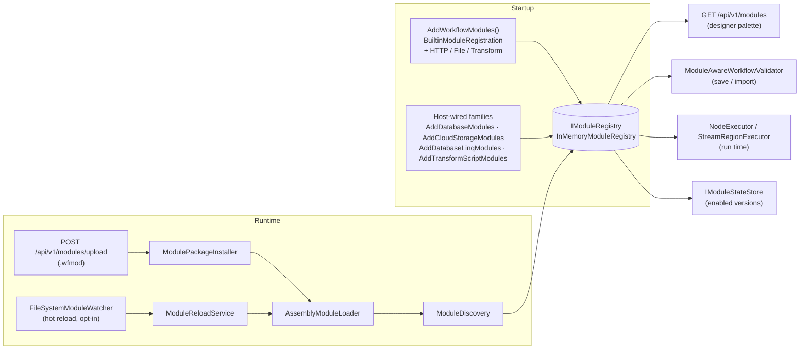
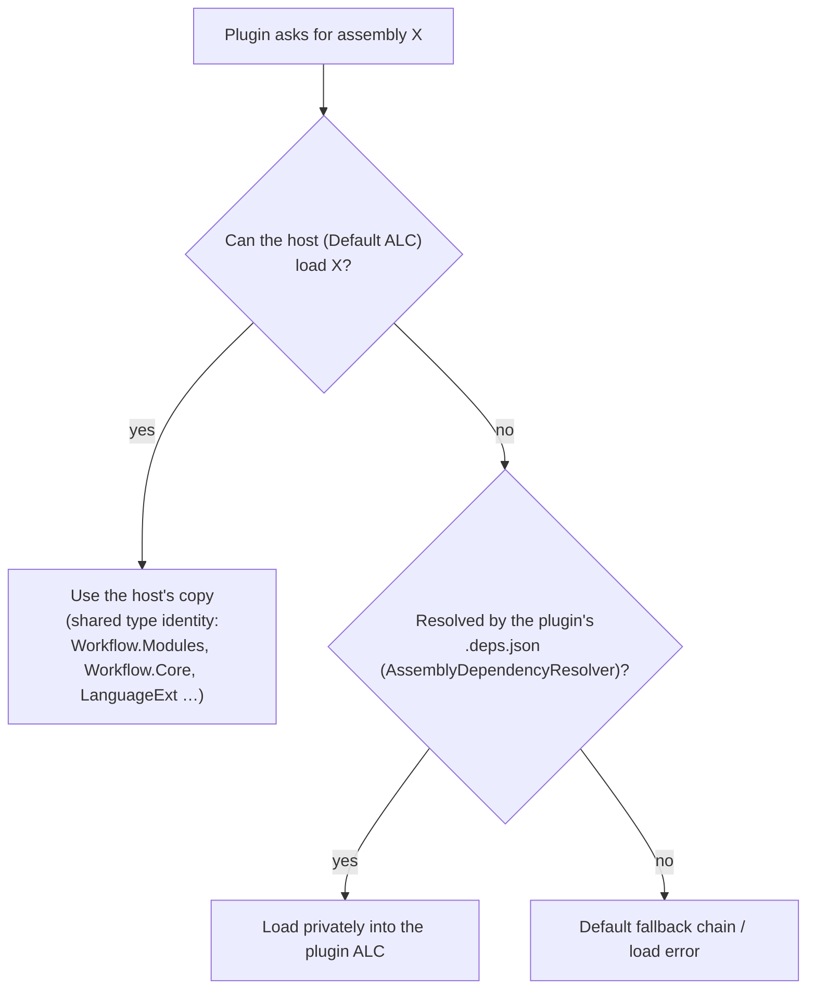
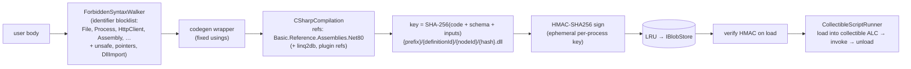

# 04 — Modules, plugins & scripting

> The extension surface: the module contract, how built-in and third-party modules reach the
> registry, how plugins are packaged, loaded, versioned and hot-reloaded, and how the script and
> typed-C# modules compile and sandbox user code. Source of truth: `Workflow.Modules/{Abstractions,
> Discovery,Loading,Packaging,Security,State,Validation,Versioning}`, `Workflow.Scripting*`,
> `Workflow.Modules.Database.Linq`, `Workflow.Modules.Transform.Script`,
> `Workflow.Api/Modules/*` at commit `7b8011e`.
>
> Up: [Architecture overview](00-overview.md) · User guides:
> [`../module-author-guide.md`](../module-author-guide.md),
> [`../module-manager.md`](../module-manager.md), [`../scripting.md`](../scripting.md),
> [`../linq-studio.md`](../linq-studio.md)

**Contents:** [The contract](#1-the-module-contract) · [Registration](#2-getting-into-the-registry) ·
[Packages](#3-wfmod-packages) · [Loading and isolation](#4-loading-and-isolation) ·
[Versions and state](#5-versions-state-and-validation) · [Hot reload](#6-hot-reload) ·
[Scripting](#7-scripting) · [Roslyn pipelines](#8-the-roslyn-pipelines) ·
[Findings to verify](#9-findings-to-verify)

---

## 1. The module contract

```csharp
public interface IWorkflowModule
{
    string ModuleId { get; }            // e.g. "builtin.http.request"
    string DisplayName, Category, Description, Icon { get; }
    Version Version { get; }
    ModuleSchema Schema { get; }        // Inputs, Outputs (PortDefinition), Properties (ModulePropertyDefinition)
    IReadOnlyList<string> Dependencies => [];
    ValidationResult ValidateConfiguration(IReadOnlyDictionary<string, object?> configuration) => Success();
    Task<ModuleResult> ExecuteAsync(ModuleExecutionContext context, CancellationToken ct = default);
}
```

| `ModuleExecutionContext` | Contents |
| --- | --- |
| `Inputs` | bound input ports, plus pass-through keys (`src.key`, `__incomingBranches__`, …) — see [02](02-data-binding-and-variables.md) |
| `Properties` | node properties, with template-enabled ones resolved |
| `Variables` | the execution's variables at dispatch time (read-only view) |
| `Logger` | `ILogger` named `Module.{moduleId}.{nodeId}` |
| `Services` | the root `IServiceProvider` |
| `ExecutionId`, `NodeId` | correlation |

| `ModuleResult` | Meaning to the engine |
| --- | --- |
| `Success`, `Outputs` | port values; failure goes through error handling ([01 §7](01-execution-lifecycle.md#7-failure-handling)) |
| `ActivePorts` | port-aware routing: only these ports fire, the rest are skipped |
| `VariableUpdates` | applied to the context and persisted per write mode |
| `Loop` / `Parallel` / `TryCatch` / `Transaction` | ask the engine to spawn a construct actor ([01 §8](01-execution-lifecycle.md#8-control-constructs)) |
| `Metrics` | extra metrics. Duration is always measured by `NodeExecutor`. |
| `Break()` / `Continue()` | reserved outputs `__loop_break__` / `__loop_continue__` |

**Lifetime.** The registry holds **one instance per module version**, and every node and every
concurrent run shares it. Modules must be stateless and thread-safe: keep per-call state in locals,
and resolve scoped services from `context.Services`.

Streaming modules also implement one of the shapes in [03 §2](03-streaming-and-spill.md#2-contracts).

---

## 2. Getting into the registry



- **Discovery** (`ModuleDiscovery`). It scans an assembly for public, concrete, non-generic types
  that implement `IWorkflowModule`. Each one is created with `ActivatorUtilities.CreateInstance`
  when services are available, or a parameterless constructor otherwise. It is then validated
  (`ModuleValidator`) and registered.
- **`[WorkflowModule]` is optional.** It can override `ModuleId`, `Category` or `Description`
  (by wrapping the module in `AttributeOverrideModule`), or exclude a type from discovery.
- **Why some families are host-wired.** `AddDatabaseModules()` can't be called from
  `AddWorkflowModules()` because of a circular reference. The Roslyn-based families (Database.Linq,
  Transform.Script) are kept out on purpose (the "Roslyn quarantine"), so the core module assembly
  never loads the compiler.
- **Observers.** `IModuleRegistry.Subscribe(IModuleRegistryObserver)` notifies subscribers on
  register and unregister.

---

## 3. `.wfmod` packages

A `.wfmod` is a zip file containing a manifest and the module's assemblies:

| `ModuleManifest` field | Used for |
| --- | --- |
| `Id`, `Version`, `DisplayName`, `Description`, `Author` | identity and catalogue |
| `EntryAssembly` | the DLL to load (it must exist after extraction) |
| `MinEngineVersion` | SemVer gate against `ModulePackagingOptions` engine version |
| `Dependencies[] {Id, MinVersion, MaxVersion}` | the installed set must satisfy each range |
| `ContentHashes` (path → base64 SHA-256) | integrity check of each listed file, when present |

`ModulePackageInstaller.InstallAsync(bytes)` does these steps in order:

1. **Read.** `ModulePackageReader` parses the manifest, checks it is structurally valid, confirms
   the entry assembly exists, and verifies `ContentHashes`.
2. **Engine version gate.**
3. **Duplicate check.** Refuse a version that is already installed.
4. **Dependency pre-check.** Each dependency id must be present, and its version range satisfied.
5. **Extract.** `PackagePath` rejects entries that would escape the package root (zip-slip).
6. **Trust policy (Stage 7.4).** A `signature.p7s` (a CMS signature over `module.json`) is checked
   against the trusted publishers; a strong-name token match is still accepted as "key pin only".
   By default the policy only warns; with `RequireSigned`, it blocks unsigned or untrusted packages.
   The verified file hashes are recorded, and every later load (startup, hot reload) re-checks
   them. See [module signing](../module-signing.md).
7. **Capture the previous schema.** The current latest version's schema is saved, for the
   compatibility diff.
8. **Load** through `AssemblyModuleLoader`.
9. **Check** that the loaded module's id matches the manifest.
10. **Diff and archive.** `ModuleSchemaComparer` compares the old and new schemas. Optionally, the
    package bytes are archived (`IModulePackageArchive`, a no-op by default).

Uninstall (`DELETE /api/v1/modules/{id}`) asks `ModuleDependencyResolver.GetDependents` first, so
a module that others depend on can't be removed out from under them.

---

## 4. Loading and isolation

Each plugin gets its own collectible `PluginAssemblyLoadContext`:



**The host's version always wins.** This is what makes `IWorkflowModule` from the plugin the same
type as the host's. It also means a plugin can't bring a different version of a library the host
already has.

> **An ALC is not a security boundary.** Plugin code runs in-process with the API's full trust:
> file system, network, environment, secrets and other workflows' data. The signature policy
> controls *which* code you load. It doesn't limit *what that code can do*.

---

## 5. Versions, state and validation

- **Multiple versions.** `InMemoryModuleRegistry` keeps several versions per id. Each version can
  be enabled or disabled (`POST /api/v1/modules/{id}/enable|disable?version=`).
- **Pinning.** A node can pin a version, and `NodeExecutor` then fails clearly if that version is
  missing or disabled. Unpinned nodes get the latest enabled version.
- **Persistent state.** Enabled and version state is kept by `IModuleStateStore`
  (`ModuleStateSnapshot` of `{ModuleId, Version, Enabled}`), so it survives restarts. There are
  two backends: `FileModuleStateStore`, and `RepositoryModuleStateStore` over the persistence
  provider's blob store (`Modules:StateStore=repository`).
- **Breaking changes.** `ModuleSchemaComparer` compares a new version's schema to the previous one
  and lists compatibility warnings: removed ports or properties, newly added *required* ones, and
  changed types. The installer reports them.
- **Validation happens at two points:**
  - **On save and import** (`WorkflowEndpoints`), with `ModuleAwareWorkflowValidator`. It adds
    module-aware checks (unknown module ids, port names, required properties) on top of the
    structural `WorkflowValidator`.
  - **On run** (`WorkflowSupervisor`), with the structural `WorkflowValidator` only.
    `WorkflowExecutor.ValidateConnectionPorts` then checks port names for the modules it can
    resolve.

---

## 6. Hot reload

Hot reload is off by default (`Modules:HotReload:Enabled`). When enabled:

1. `ModuleHotReloadHostedService` runs a `FileSystemModuleWatcher` over the installed-modules
   folder. Loose-DLL dev folders are watched too, if enabled.
2. When a watched assembly changes, `ModuleReloadService.ReloadAsync(path)` waits until
   `IActiveExecutionTracker.HasActiveExecutions` is false. It polls every 100 ms for up to 30 s,
   then gives up with `TimedOut`.
3. It unloads the old ALC, then loads and discovers the new assembly.
4. Observers get `ModuleReloadedInfo`. The host republishes it on the Akka `EventStream`.

The drain gate is **global**: any running execution blocks every reload. It is also only as good
as the tracker behind it (see §9).

---

## 7. Scripting

`builtin.script` runs user code in one of three languages. All three share one API surface.

| Language | Executor | Engine | Limits enforced |
| --- | --- | --- | --- |
| JavaScript (default) | `JavaScriptScriptExecutor` | Jint 4.9 | `LimitMemory`, `TimeoutInterval`, `LimitRecursion`, `Strict`, cancellation. **`AllowClr()` is on** (see §9). |
| Lua | `LuaScriptExecutor` | MoonSharp, `CoreModules.Preset_SoftSandbox` | Timeout through a linked CTS, with the body run as a coroutine so auto-yield can stop it between chunks |
| C# | `CSharpScriptExecutor` | Roslyn (see §8) | compile-time blocklist, reference set, collectible ALC, timeout |

### Configuration and capabilities

- **Node properties** request a timeout, a memory limit, `allowNetwork`, `allowFileSystem`,
  `allowedPaths` and a maximum number of HTTP requests.
- **`ScriptExecutionConfig.ClampTo(ScriptHostCeilings)`** caps each request at the host limit
  (config section `Scripting`):

  | Ceiling | Default |
  | --- | --- |
  | `MaxTimeoutSeconds` | 120 |
  | `MaxMemoryBytes` | 256 MB |
  | `AllowNetwork` | true |
  | `AllowFileSystem` | false |
  | `MaxHttpRequests` | 50 |
  | `AllowedRootPaths` | none |

- **Node defaults:** 30 s timeout, 64 MB memory, no network, no files, 10 HTTP requests.

### The `workflow.*` API (`WorkflowScriptApi`)

| Group | Members |
| --- | --- |
| Variables | `getVariable`, `setVariable`, `deleteVariable`, `variableExists`. Writes come back as `VariableUpdates`. |
| Logging | `logDebug`, `logInfo`, `logWarning`, `logError`. These are captured and returned with the result. |
| Utilities | `newGuid`, `now`, `utcNow`, `formatDateTime`, `hash`, `parseJson`, `toJson`, `parseCsv`, `toCsv` |
| Context | `getExecutionId`, `getWorkflowId`, `getNodeId` |
| HTTP | `httpGet`, `httpPost`, `httpPut`, `httpDelete`. Gated by `AllowNetwork` and `MaxHttpRequests`. |
| Files | `readFile`, `writeFile`, `fileExists`, `deleteFile`. Gated by `AllowFileSystem` and `AllowedPaths`. |
| Libraries | `workflow.require(id)`. Libraries come from `IScriptLibraryStore`, which is persisted to the blob store when one exists. |

Script Studio calls the same executors through `/api/v1/scripts`: `POST /test`,
`GET /languages`, and CRUD on `/libraries/{id}`.

---

## 8. The Roslyn pipelines

Two module families compile user C#. They share the design, and the Linq family keeps its own copy
of the compiler host:

| | `builtin.transform.script` | `builtin.database.linq` |
| --- | --- | --- |
| Project | `Workflow.Modules.Transform.Script` on `Workflow.Scripting.Roslyn` | `Workflow.Modules.Database.Linq` (own copy) |
| User writes | a method body over typed `input` | a LINQ query over a generated typed `DataContext` |
| Codegen | wrapper class with fixed usings | `DynamicContextCodeGenerator` from the workflow's table catalogue + `LinqInputsCodeGenerator` |
| Endpoints | `/api/transform/script/{validate,preview,compile}` | `/api/database/linq/*` (LINQ Studio) |



- **Deterministic cache keys.** Editing the code, the schema or the input shape invalidates the
  cache automatically.
- **Signing guards the blob store.** The HMAC stops a tampered blob from being loaded. The key is
  ephemeral (`EphemeralScriptHmacKeyProvider`), so every restart recompiles, and blob-cached
  assemblies only help within one process lifetime.
- **Unloading.** Each run gets a fresh collectible ALC, which is unloaded afterwards so compiled
  scripts don't pile up in memory.

---

## 9. Findings to verify

1. **The JavaScript sandbox may be escapable. (High.)**
   - What the code does: `JavaScriptScriptExecutor` enables `opts.AllowClr()`. In Jint, that
     turns on CLR interop, and Jint's own README shows `new System.IO.StreamWriter('log.txt')`
     working under exactly this option. `allowNetwork` / `allowFileSystem` only gate the
     `workflow.*` API.
   - Why it matters: if the escape works, a script could reach `System.IO` / `System.Net`
     directly and bypass both gates.
   - Verify: run `return System.IO.File.Exists('/etc/hosts');` and
     `var f = importNamespace('System.IO').File; return f.Exists('/etc/hosts');` through the
     executor.
   - Likely fix: drop `AllowClr()`. The `__api` object is set with `SetValue` and doesn't need it.
     Or pass an explicit empty assembly list and set `Interop.AllowGetType = false`.
2. **The C# blocklist is not a sandbox.**
   - What the code does: both walkers reject *identifiers* (`File`, `Assembly`, `Activator`, …),
     but the compilation references the whole .NET 8 BCL. Reflection that never names a banned
     identifier gets through the walker, for example
     `Type.GetType("System.IO.File").GetMethod("ReadAllText", new[] { typeof(string) }).Invoke(…)`.
   - Why it matters: the code then runs in-process with full trust.
   - Fix options: add reflection entry points (`GetType(string)`, `GetMethod`, `Invoke`,
     `MethodInfo`, `Type`) to the blocklist, and trim the reference set to an allowlist. Or treat
     C# scripts and plugins as trusted-author only, and gate them behind the Admin role.
3. **The active-execution count only drops for sync runs.**
   - What the code does: `ActorWorkflowExecutionService` records `Started` for every run, but
     records `Completed`/`Failed`/`Cancelled` only in `StartAndWaitAsync`. Webhook launches never
     record at all.
   - Effect: after the first async run, `IWorkflowMetrics.Active` never returns to zero. That
     makes the `/metrics` active gauge wrong, and it means `MetricsActiveExecutionTracker`
     reports activity forever, so **every hot reload times out** after 30 s.
4. **`IWorkflowModule.ValidateConfiguration` is never called.** Many built-ins implement it, but
   neither the validators nor the engine invoke it, so the checks those modules wrote never run.
5. ~~**Strong-name tokens aren't signatures.**~~ **Fixed (Stage 7.4):** signed packages (a CMS
   signature over `module.json`, which hashes every file) by a trusted publisher (pinned certificate
   or CA root). Every load re-checks the files against the install record. The token check is kept,
   labelled "key pin only". See [module signing](../module-signing.md). Original note:
   - What the code does: `StrongNameVerifier` compares `GetPublicKeyToken()` against a trusted
     list.
   - Why it matters: .NET doesn't verify strong-name signatures, and anyone can build an assembly
     with a copied public key. `RequireSigned` identifies the publisher by assertion only. It
     doesn't prove who built the file. `ContentHashes` in a manifest from the same untrusted
     upload doesn't add trust either. Authenticode (2.8.P2) is the real fix.
6. ~~**Script HTTP has no host allowlist.**~~ **Fixed (Stage 7.3):** an outbound HTTP policy for
   script HTTP *and* the HTTP Request module, with separate channels; modes Public only / Internal
   only / Allowlist only / Unrestricted; deny lists; an explicit cloud-metadata switch;
   connect-time IP checks; and a setup screen. Unconfigured channels fail closed (Public only). See
   [outbound HTTP](../outbound-http.md).
7. **Discovery registers any public `IWorkflowModule` in an uploaded assembly.** A package can
   register more module ids than its manifest names. The installer only checks that the manifest
   id is among them.
