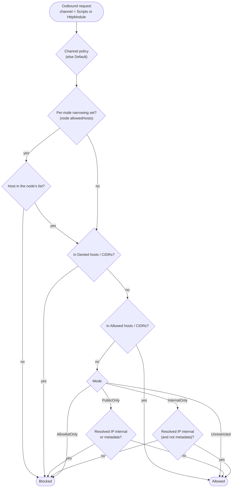

# Plan 06 — Outbound HTTP policy (SSRF), Stage 7.3

**Finding:** 04 §9.6. With `allowNetwork` on, script HTTP (`workflow.httpGet/Post/Put/Delete`) can
reach any URL, including the cloud metadata endpoint (`169.254.169.254`), `localhost` and internal
services. The built-in **HTTP Request** module, and its OAuth2 token call, can too. When a URL comes
from data (`{{input.url}}`), that's the same server-side request forgery risk.

**Status:** implemented 2026-11-09 (Stage 7.3); user docs in `docs/outbound-http.md`. Decided 2026-11-09 (asked twice). See §8 for the answers to the open questions; they
override the proposals in §3–§6 where they differ.

---

## 1. What the user decided so far

| Question | Answer |
| --- | --- |
| Which traffic? | **Both** scripts and the HTTP Request module, with **separate settings** for each. |
| Default? | **No single right default.** "Internal allowed, external by allowlist" is as valid as "external allowed, internal blocked". Offer clear **modes**, and when the policy is **unconfigured**, show a **setup screen or a clear warning**. |
| Where configured? | **Host settings + per-node narrowing** (for DMZ / DMZ-edge deployments). **Plan for configuring it in the UI** later, even if not built now. |
| Enforcement? | Decide once the above is settled (this plan proposes it in §5). |

---

## 2. The policy model

Each **channel** has its own policy:
- `Scripts`: `workflow.http*` in JavaScript, Lua and C#;
- `HttpModule`: the HTTP Request module, including its OAuth2 token call.

A channel that isn't set inherits the `Default` policy.

A policy is a **mode** plus lists:

| Mode | Internal addresses¹ | Public internet | Typical deployment |
| --- | --- | --- | --- |
| `Unrestricted` | ✅ | ✅ | today's behaviour; dev boxes |
| `PublicOnly` | ❌ unless in `AllowedInternal` | ✅ | SaaS-style: call public APIs, never the inside |
| `InternalOnly` | ✅ | ❌ unless in `AllowedExternal` | on-prem integration hub: inside freely, only named partners outside |
| `AllowlistOnly` | only `Allowed*` | only `Allowed*` | DMZ / locked-down |

¹ *Internal* = loopback (127/8, ::1), private (10/8, 172.16/12, 192.168/16, fc00::/7), link-local
(169.254/16, fe80::/10), CGNAT (100.64/10), and unspecified/broadcast addresses.

**Lists** (all modes):
- `AllowedHosts`: exact (`api.partner.com`) or wildcard (`*.partner.com`) host names.
- `AllowedCidrs`: address ranges (`10.20.0.0/16`).
- `DeniedHosts` / `DeniedCidrs`: **deny always wins**, in every mode.

**Cloud metadata** (`169.254.169.254`, `fd00:ec2::254`, `metadata.google.internal`): proposed to be
**blocked in every mode except `Unrestricted`**, unless explicitly listed in `AllowedHosts` /
`AllowedCidrs`. Being internal doesn't make it reachable under `InternalOnly`, because it's the
classic SSRF target. *(Open question O3.)*



A blocked request fails the node with a message that names the host, the resolved IP, the channel
and the rule that blocked it, plus which setting to change. For example:
> Outbound HTTP to 169.254.169.254 (metadata) was blocked by the HttpModule policy (mode
> PublicOnly). Add it to Http:Outbound:HttpModule:AllowedHosts if this is intended.

---

## 3. "Unconfigured" — setup screen and warnings

A policy is **unconfigured** when neither the channel nor `Default` sets a `Mode`.

**Proposal:** unconfigured behaves like **`Unrestricted`**, so nothing that works today breaks, but
it is **loud** about it:
- **Startup:** a warning log per unconfigured channel, naming the setting.
- **API:** `GET /api/v1/status` gains `outboundHttp: { scripts: { mode, configured }, httpModule: {…} }`.
- **Designer:** a dismissible banner, *"Outbound HTTP isn't configured — workflows can reach any
  address, including internal services. Set it up…"*, linking to the setup screen (§4).
- **Run time:** none. Not warning per request keeps logs quiet.

*(Open question O1: unconfigured = `Unrestricted` + warnings, or fail closed = `PublicOnly` +
warnings.)*

---

## 4. Where it's configured — now and later

**Now (v1): host settings**, e.g. `appsettings.json` or environment variables:

```jsonc
"Http": {
  "Outbound": {
    "Default":   { "Mode": "PublicOnly" },
    "Scripts":   { "Mode": "AllowlistOnly", "AllowedHosts": [ "api.partner.com" ] },
    "HttpModule":{ "Mode": "InternalOnly", "AllowedExternal": [ "*.partner.com" ], "DeniedCidrs": [ "10.0.5.0/24" ] }
  }
}
```

**Per-node narrowing (v1):** an optional `allowedHosts` property on the HTTP Request node, and on
script nodes (alongside `allowNetwork`). When set, the request must match it **and** the channel
policy. It can only narrow, never widen. This is for DMZ-edge nodes that should only ever talk to
one partner.

**Later (v2): configured in the UI** (an Admin-only setup screen). Planned now so v1 doesn't paint
us into a corner:
- `IOutboundHttpPolicyProvider` returns the effective policy per channel. In v1 it's backed by
  settings; in v2 it combines settings with a policy saved through the API (persistence-backed, so
  every host in a cluster agrees).
- **Precedence:** a value set in host settings is **locked**. The UI shows it read-only ("set by the
  server administrator"). Anything not set in host settings can be edited in the UI. So operators
  keep a hard ceiling, and teams without config access can still self-serve.
- The setup screen walks through: choose a mode per channel (with the table above), add hosts /
  ranges, and test an address ("would `http://10.1.2.3/` be allowed for Scripts?"). The test uses
  `POST /api/v1/settings/outbound-http/check`, which v1 can ship as the read-only half.
- Changes are audited (who, when, before/after).

---

## 5. Enforcement (proposal, follows from §2)

The `PublicOnly` / `InternalOnly` modes need to know whether a destination is **internal**. That's
a property of the **IP address**, not the URL text, so enforcement has to look at the address the
client actually connects to:

1. **Separate named clients per channel:** `dotflow.http` (module) and `dotflow.script.http`
   (scripts). Each gets a `SocketsHttpHandler` whose **`ConnectCallback`** resolves the host,
   applies the channel's mode and CIDR rules to every resolved address, and connects only to an
   allowed one. That one check covers redirects, DNS rebinding and hosts that resolve to private
   IPs.
2. **Host-name rules** (`AllowedHosts` / `DeniedHosts` wildcards, per-node `allowedHosts`) are
   checked by a `DelegatingHandler` on **every hop**. Automatic redirects are turned off on the
   handler and followed by the delegating handler (same max: 10), re-checking each hop. The HTTP
   module's `followRedirects` property keeps working.
3. **Proxies:** if an HTTP proxy is configured, the IP check would only see the proxy. In that case,
   host-name rules still apply, and a startup warning says IP-based modes depend on the proxy.
   *(Open question O5.)*
4. **Not covered by the client policy:** a C# script that a ScriptApprover approved (§9.2) to use
   `System.Net` directly can make its own `HttpClient`. The approval screen will say so. Blocking it
   would need a process-level egress control (firewall / network policy), which is documented as
   the defence in depth.

---

## 6. Phasing

| Phase | Contents |
| --- | --- |
| **v1** | Policy model + modes + lists; separate channels; `ConnectCallback` IP check + per-hop host check; per-node `allowedHosts`; unconfigured warnings (startup log, status API, designer banner); clear block messages; docs `docs/outbound-http.md` with the alternatives; tests incl. redirect-to-internal and DNS-to-private |
| **v1.1** | `POST …/outbound-http/check` (read-only "would this be allowed?"), used by the banner's "check an address" box |
| **v2** | Admin setup screen writing the policy via the API; persistence-backed provider; locked host settings; audit |

---

## 7. Open questions (need answers before coding)

- **O1 — Unconfigured behaviour:** `Unrestricted` + loud warnings (nothing breaks), or fail
  closed as `PublicOnly` + warnings (safer, may break workflows that call internal services)?
- **O2 — The modes:** are `Unrestricted` / `PublicOnly` / `InternalOnly` / `AllowlistOnly` the
  right four?
- **O3 — Metadata:** blocked in every mode except `Unrestricted` unless explicitly allowed?
- **O4 — v1 scope:** build only the setup *banner* + status API now (setup screen in v2), or the
  setup screen too?
- **O5 — Enforcement:** the §5 approach (connect-time IP check + per-hop host check)?

---

## 8. Decisions on the open questions (2026-11-09, asked)

| | Decision |
| --- | --- |
| **O1 Unconfigured** | **Fail closed:** an unconfigured channel behaves as **`PublicOnly`**, plus the warnings in §3 (startup log, status API, designer banner → setup screen). *Overrides §3's proposal.* Upgrade note: workflows that call internal services stop working until an admin picks a mode. |
| **O2 Modes** | The four modes as in §2 (`Unrestricted`, `PublicOnly`, `InternalOnly`, `AllowlistOnly`), with Allowed/Denied hosts and CIDRs, where deny always wins. |
| **O3 Metadata** | **An explicit option:** `AllowCloudMetadata` per channel (default **false**). Metadata addresses are blocked in **every** mode, `Unrestricted` included, unless this option is on. Listing a metadata address in `AllowedHosts` / `AllowedCidrs` is **not** enough on its own. *(This is how the answer "have as explicit option" was read; revisit if wrong.)* |
| **O4 v1 scope** | **The setup screen is in v1.** That means a persisted policy, an Admin API, the `IOutboundHttpPolicyProvider` with **locked** host settings, an audit trail and the designer setup page. The §6 v2 row moves into v1. |
| **O5 Enforcement** | As in §5: separate channel clients, a connect-time IP check, and a per-hop host check with manual redirects. |

### Alternatives (kept for a pivot)
- **Unconfigured = `Unrestricted` + warnings:** nothing breaks on upgrade, but it's unsafe until an
  admin acts.
- **No modes, just allow/deny lists:** simpler, but "block all internal" means listing the private
  ranges yourself.
- **Metadata as an implicit special case** (blocked except under `Unrestricted`, or when listed),
  or treated like any other internal address.
- **Setup screen deferred** (v1 = settings + warnings only).
- **URL check with redirects off** instead of the connect-time IP check: simpler, but a public
  name that resolves to a private IP gets through.
