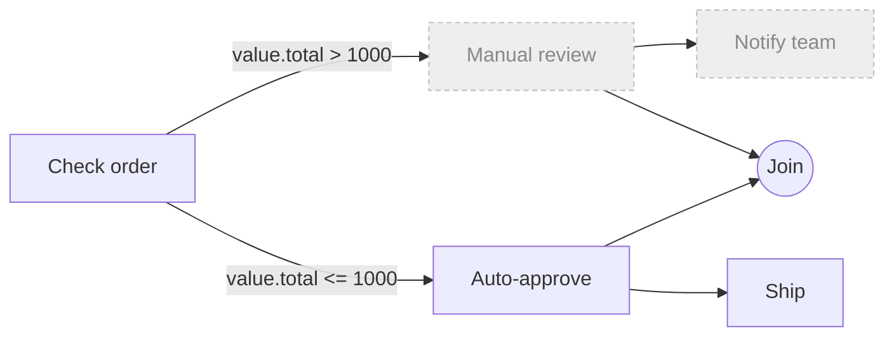
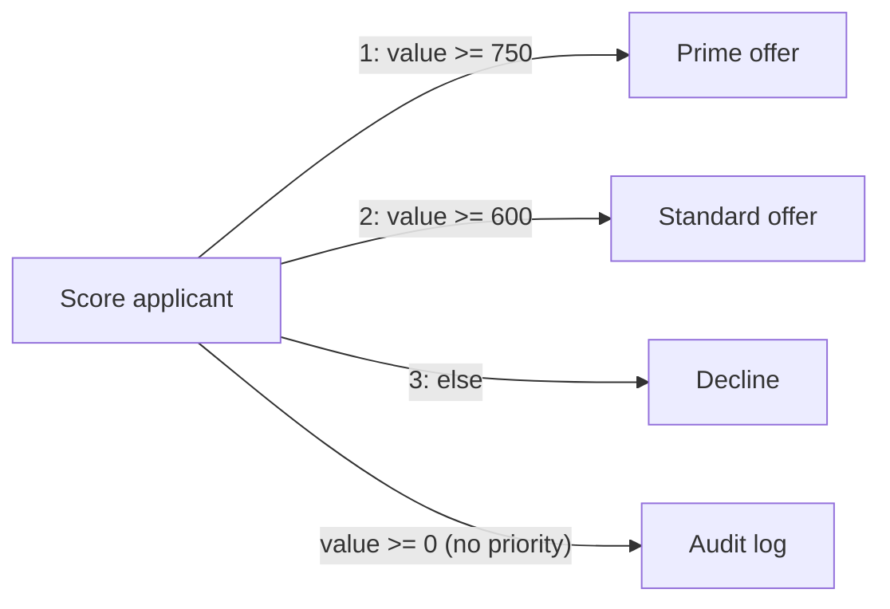
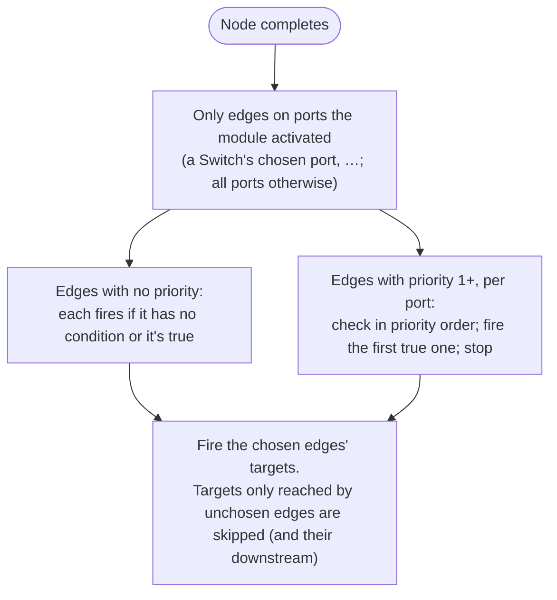

# Conditional edges — routing with conditions and priority

Any connection can carry a **condition**. The edge only fires when the condition is true. Edges
leaving the same output port can also be given a **priority**, which turns them into an
**if / else-if / else** chain where only the first true edge fires.

In the designer, select a connection. **Condition** and **Priority** are in the properties panel,
and the edge label shows them (`value > 10`, `2: value > 10`, `3: else`). In JSON they are the
connection's `condition` and `priority` fields.

> Before you reach for these: a **Condition** or **Switch** node does the same job with ports. Use
> those when the decision deserves its own visible step. Use edge conditions when the decision is
> about *where this one output goes*.

---

## Writing a condition

A condition uses the same expression language as `{{…}}` templates (sandboxed JavaScript). Write it
**without** braces; braces are accepted too.

| You write | Meaning |
| --- | --- |
| `value` | what travels on this edge: the source node's output on this port |
| `value.status == 200` | a path into it |
| `Variable.retries < 3` | a workflow variable (including `item` / `index` / `error` inside bodies) |
| `fetch.count > 0` | another node's output: any node upstream of the source |
| `value.items.length > 0 && Variable.enabled` | combine with `&&`, `\|\|`, `!` |

The result must be **true or false**. `value.status` on its own isn't a condition; `value.status == 200` is.

---

## What happens when it's false

A false edge behaves exactly like an **unused port** of a Condition or Switch node:

With `value.total = 250`:
- **Auto-approve** runs.
- **Manual review** is skipped, and so is everything only reachable through it (Notify team).
- **Join** still runs, because another edge (from Auto-approve) reaches it. A false edge gives it
  **no input**: no value on that port, and none of the source's outputs. This holds whichever of
  its predecessors finishes last. A node that any predecessor activated always runs once they're
  all done.

---

## When a condition can't be evaluated

A syntax error, a reference to something that doesn't exist, or a result that isn't true/false all
count as **a failure of the source node**. The message names the edge and the expression, for
example:

> The condition on the connection check.output → review.input couldn't be evaluated: 'value.totl > 1' …

Because it's a node failure, the source node's **On error** setting applies: Fail, Continue, Retry,
or an [error handler](error-handling.md). The designer flags a reference to a node that isn't in
the workflow before you run.

---

## Priority: if / else-if / else

Edges from **the same output port** that have a **Priority of 1 or more** form a chain:
- They're checked in priority order (lowest first; ties go by the order the edges were added).
- **Only the first one whose condition is true fires.**
- An edge in the chain with **no condition** is the "else": it always matches, so put it last.
- Once one fires, the conditions of later edges **aren't evaluated**.

Edges with **no priority** (blank or 0) are **independent**. Each fires on its own condition,
alongside whatever the chain picks.

| `value` | Fires |
| --- | --- |
| 800 | Prime offer + Audit log |
| 650 | Standard offer + Audit log |
| 400 | Decline + Audit log |

Chains are per **port**. Edges on a different output port of the same node form their own chain.

The designer warns when an edge in a chain has no condition but isn't last: the edges after it can
never fire.

---

## Where conditions don't apply

- **Edges leaving a construct** (For Each, While, Parallel, Fan Out, Try/Catch, transaction): the
  construct routes its own ports, so a condition or priority there is ignored. The designer warns.
- **Streaming edges** (between streaming ports): items flow continuously, so there's no single
  value to test. Ignored; the designer warns.

---

## Alternatives if we want to change this behavior

Decided 2026-11-08 (plan 03 Finding E, Stage 7.2). These are the options we didn't pick, each with
what would change.

### Priority — the main alternatives

**P1. Priority unused (all true edges fire).** Every edge fires on its own condition, and
`priority` is documented as reserved.
- *For:* simplest; no ordering to explain.
- *Against:* if/else needs mutually exclusive conditions written out by hand (`>= 750`,
  `>= 600 && < 750`, `< 600`), or a Switch node.
- *Change:*
  - In `EdgeRouting.Fired`, treat every edge like priority 0 (drop the chain loop).
  - Remove the designer's Priority field and the `n:` label prefix (`EdgeConditions.Label`), and the
    chain lint.
  - Rewrite `ConditionalEdgeTests.PriorityEdges_…` / `OnceAPriorityEdgeWins_…`.

**P2. Remove Priority entirely.** As P1, and delete `ConnectionDefinition.Priority` from the model,
the API DTOs and the designer.
- *Against:* a breaking API/JSON change for anyone who set it; it was never read, though.

**P3. Priority orders *all* outgoing edges, not per port.** The chain spans every port of the node.
- *For:* one chain per node.
- *Against:* surprising when a module activates several ports (a Switch), because one port's edges
  would suppress another's.
- *Change:* group by node instead of by `SourcePortName` in `EdgeRouting.Fired` and in
  `EdgeConditions.Validate`.

**P4. Priority = evaluation order only (all true edges still fire).** Conditions run in priority
order, but nothing is exclusive.
- *For:* deterministic side effects if conditions ever have them.
- *Against:* they don't (the sandbox is pure), so it buys nothing visible.
- *Change:* in `EdgeRouting.Fired`, remove the `break`.

**P5. No implicit "else".** An unconditional edge in a chain is a designer error rather than "else".
- *Change:* make the chain lint an error, or reject it at save. The engine needs no change.

**P6. Highest number wins** instead of lowest.
- *Change:* flip the `OrderBy` to `OrderByDescending` in `EdgeRouting.Fired`, and in the docs and
  lint wording.

### Other choices

**C1. Full `{{…}}` syntax only, no `value`.** Conditions would use exact template syntax
(`{{check.output.total}} > 1000`).
- *Change:* stop seeding `value` in `PropertyBinder.EvaluateCondition`, and update the docs,
  placeholder and help.

**C2. A false edge blocks its join.** A false edge counts as "not satisfied", so a join never runs
if any incoming edge is false.
- *Change:* in `DispatchCore.ExecuteReadySuccessorsVia`, mark the target blocked instead of skipping
  it; `TryFireSuccessor` must check the inactive edges.

**C3. A bad condition counts as false (plus a warning)** instead of failing the source node.
- *Change:* in `EdgeRouting.Fired`'s `Passes`, return false and log instead of throwing; drop the
  `EdgeConditionException` handling in the executors.

**C4. Conditions on construct edges.** Evaluate them on a construct's `done` (or other non-body)
ports too.
- *Change:* `ConstructSpawnCore` would route its done port through `EdgeRouting` with the
  construct's outputs.

---

*Where it lives:*
- **Engine:** `Workflow.Engine/Actors/EdgeRouting.cs` (which edges fire),
  `DispatchCore.ExecuteReadySuccessorsVia`, the `FiredEdges` / `RouteVia` and `_inactiveEdges` hooks
  in `WorkflowExecutor` / `SubGraphExecutor`, and `PropertyBinder.EvaluateCondition`.
- **Designer:** `Designer/State/EdgeConditions.cs`, the connection section of
  `PropertiesPanel.razor`, `EditConnectionPriorityCommand`, and the label in `EdgeLayer.razor`.
- **Tests:** `Workflow.Tests/Engine/ConditionalEdgeTests.cs` and
  `Workflow.Tests.UI/State/EdgeConditionsTests.cs`.
