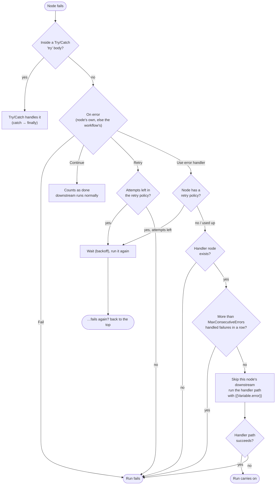
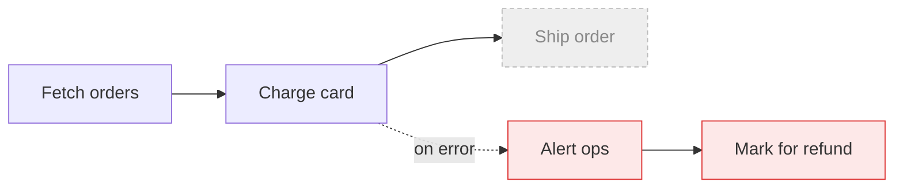
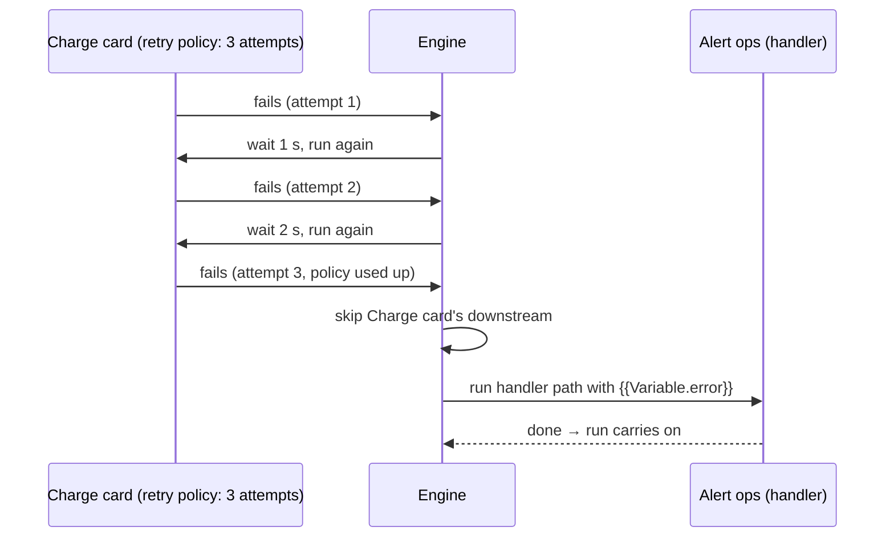
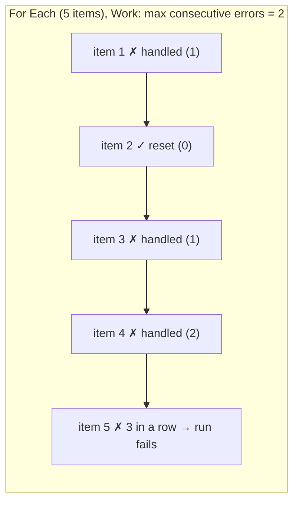

# Error handling — what happens when a node fails

Every node has an **On error** setting. It's in the designer's properties panel, or under
`errorHandling` in the workflow JSON. A workflow can set a default in its top-level
`errorHandling`, which applies to every node that doesn't set its own.

| Setting (`onErrorBehavior`) | What happens when the node fails |
| --- | --- |
| **Fail** (default) | The run stops and is marked failed. |
| **Continue** | The node counts as done; its downstream runs as if it had succeeded. |
| **Retry** | The node runs again, following its retry policy (default: 3 attempts, 1 s → 2 s backoff, 60 s cap). If every attempt fails, the run fails. |
| **Use error handler** | The node's **error handler** runs (see below); its downstream is skipped and the run carries on. |

Two things come before this setting:
- A node inside a **Try/Catch** `try` body is caught by that Try/Catch first.
- With **Retry** or **Use error handler**, a retry policy is used up before anything else happens.

---

## The decision, step by step



---

## "Use error handler" in detail

You pick a node to be the **handler** (`errorNodeId`). When the node fails, after any retries:

1. **The failed node's downstream is skipped.** Nothing that depended on its output runs.
2. **The handler runs, followed by its own outgoing path**, like a catch body. The error is
   available on that path as **`{{Variable.error}}`**:
   - `{{Variable.error.message}}`: the error message;
   - `{{Variable.error.errorType}}`: the exception type;
   - `{{Variable.error.nodeId}}`: the node that failed;
   - `{{Variable.error.occurredAt}}`: when it happened.
3. **The run carries on.** It ends as *completed*, unless something on the handler path fails.
   Then the run fails with "The error handler for node 'X' failed: …".



*Charge card fails* → **Ship order is skipped**, then **Alert ops → Mark for refund** runs with
`{{Variable.error}}`, and the run completes.

### Handler nodes don't run on their own

A node chosen as a handler runs **only when a failure routes to it**. Normally, every node without
incoming connections starts when the run begins; handler nodes are the exception. The same goes
for the nodes after a handler that can *only* be reached through it (Mark for refund above).

If you also wire a connection **into** the handler node, it runs normally through that connection
too. The "on error" route is an extra way in, not a replacement.

### The handler path is its own scope

The handler path is the handler plus every node reachable only through it. It runs in its own
scope, like a catch body:
- `{{Variable.error}}` exists only on that path, and doesn't leak to the rest of the run.
- Variable writes on the path (Set Variable) are visible to the rest of the run once the path
  finishes.
- `{{nodeId.port}}` on the path can read any node that ran before the failure and is upstream of
  the handler path (see [variables](variables.md#referencing-variables)).
- Run history records the path's nodes with a scope step `<failed node>!onError`.

### Retries come first

If the node has a **retry policy**, it's retried as usual and the handler only runs once the
attempts are used up. Without a retry policy, the handler runs on the first failure.



### Max consecutive errors

`maxConsecutiveErrors` caps how many **handled failures in a row** a node may have before the run
fails anyway, with "Node 'X' failed N times in a row, more than its MaxConsecutiveErrors (M)".
- The count is **per node, for the whole run**, so it spans loop iterations.
- A **success** of that node resets it to zero.
- Left empty, there's no limit.



### Inside loops and other bodies

A node inside a loop / branch / try body can use an error handler too. The handler path runs
inside that iteration or branch, which then carries on (the loop moves on to its next item). If
the handler path fails, it's that body that fails, and the usual rules apply from there (e.g. an
enclosing Try/Catch).

### The workflow-level default

Setting **Use error handler** in the workflow's own `errorHandling` makes that handler the
default for every node that doesn't set its own. It's a quick way to say "alert someone whenever
any step fails, but keep going".

---

## Error handler or Try/Catch?

| | Use error handler (per node) | Try/Catch (construct) |
| --- | --- | --- |
| Protects | one node | a whole sub-graph (the `try` body) |
| Shape on the canvas | a dashed **on error** link | a node with `try` / `catch` / `finally` / `done` ports |
| After the failure | failed node's downstream skipped; handler path continues | `catch`, then `finally`, then `done` |
| Error available as | `{{Variable.error}}` on the handler path | `{{Variable.error}}` in the catch body |
| Re-throw | no (a failing handler fails the run) | `rethrow: true` |
| Bounded repeats | `maxConsecutiveErrors` | — |
| Precedence | — | wins: a node in a `try` body is caught by the Try/Catch first |

Use **Try/Catch** for "this group of steps can fail together" or when you need `finally`. Use an
**error handler** for "if this one step fails, do this instead and keep going".

---

## In the designer

- **Properties → On error:**
  - *Fail the run* / *Continue as if it succeeded* / *Retry, then fail* / *Run an error handler*.
  - *Run an error handler* adds an **Error handler** picker. It lists nodes that aren't
    downstream of this one, because a downstream node is skipped when this one fails and so
    can't handle the error.
  - It also adds a **Max consecutive errors** field.
- **Canvas:** a dashed red **on error** link from the node to its handler.
- **Checks:**
  - an error when no handler is chosen;
  - an error when the handler is missing, is the node itself, or is downstream of it;
  - a warning for a max of 0 or less;
  - an error when the workflow-level default names a missing handler.
- The save-time server checks are unchanged. The engine fails the node clearly if the handler is
  missing at run time.

```json
{
  "id": "charge",
  "moduleId": "payments.charge",
  "errorHandling": { "onErrorBehavior": "UseErrorHandler", "errorNodeId": "alert", "maxConsecutiveErrors": 3 },
  "retryPolicy": { "maxAttempts": 3, "delayMs": 1000, "backoffMultiplier": 2.0, "maxDelayMs": 60000 }
}
```

---

## Alternatives if we want to change this behavior

The behaviour above was decided on 2026-11-08 (plan 02 Finding F, §12.7). These are the other
options we considered, kept here so we can switch without re-deriving them. Each one says what
would change.

### A. "Handler, then continue downstream"
After the handler runs, the failed node's **downstream also runs**, as with *Continue*.
- *For:* one setting gives you "log it and carry on with the normal flow".
- *Against:* downstream nodes run without the failed node's outputs, which can cause confusing
  follow-on failures.
- *Change:*
  - `WorkflowExecutor.RunErrorHandler` / `SubGraphExecutor.RunErrorHandler` route successors
    normally (`ExecuteReadySuccessors(nodeId)`) instead of with `NoPortFires`.
  - Flip `ErrorHandlerTests.Failure_RunsTheHandlerPath_…` (`after.Calls` = 1).
  - Update this page's diagrams.

### B. Handler only (ignore the handler's outgoing connections)
Only the handler node runs; its own path does not.
- *For:* simpler mental model.
- *Against:* you can't chain "alert → mark for refund" without a Try/Catch.
- *Change:*
  - `ErrorHandlerCore.ScopeOf` returns just the handler.
  - The handler's successors must then be excluded from the run some other way, e.g. a validator
    rule that a handler has no outgoing connections.

### C. Handler immediately (no retry first)
`UseErrorHandler` never retries; retry and handler stay mutually exclusive.
- *Change:* drop the `RetryPolicy` branch in `NodeFailureCore`'s `UseErrorHandler` case.

### D. A handler must have no inputs
The validator rejects a handler node that also has incoming connections, so a handler is *only*
ever an error path.
- *Change:* add a `GraphValidator` / `NodeErrorHandling.Validate` rule plus a server validator
  rule. The engine needs no change.

### E. Workflow-level "on run failure" hook only
Drop the per-node setting. Keep only `workflow.errorHandling.errorNodeId` as a hook that runs
**once, when the run is about to fail** (e.g. send an alert), and the run still ends failed.
- *Change:*
  - `FailWorkflow` would start the hook and wait for it before reporting.
  - The per-node UI goes away.
  - `ErrorHandlerTests` are rewritten around the hook.

### F. Retire it in favour of Try/Catch
Mark `UseErrorHandler` / `ErrorNodeId` / `MaxConsecutiveErrors` obsolete. The validator rejects
`UseErrorHandler` and points to Try/Catch.
- *Change:*
  - Remove `ErrorHandlerCore`, the designer section and the canvas link.
  - Keep the docs' Try/Catch guidance.

### G. Different `MaxConsecutiveErrors` counting
- **Per scope instead of per run:** reset the count for each loop run, by keying
  `ErrorHandlerCounters` by `(execution, scope path, node)`.
- **Total instead of consecutive:** don't reset on success. Remove the two
  `ErrorHandlerCounters.Reset` calls in the executors' node-completed handlers.

---

*Where it lives:*
- **Engine:** `Workflow.Engine/Actors/NodeFailureCore.cs` (the decision),
  `ErrorHandlerCore.cs` (handler sets and paths, running them, `ErrorHandlerCounters`), and the
  `RunErrorHandler` callbacks in `WorkflowExecutor` / `SubGraphExecutor`.
- **Designer:** `Designer/State/NodeErrorHandling.cs`, the *On error* section of
  `PropertiesPanel.razor`, and the link in `EdgeLayer.razor`.
- **Tests:** `Workflow.Tests/Engine/ErrorHandlerTests.cs`, `Workflow.Tests.UI/State/NodeErrorHandlingTests.cs`,
  and `Workflow.Tests.UI/Components/OnErrorPanelTests.cs`.
