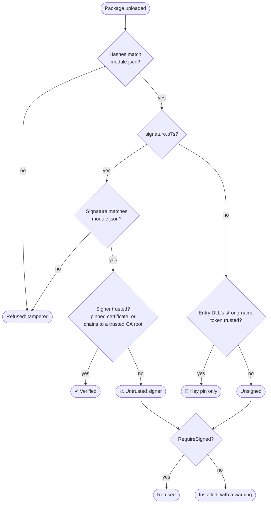
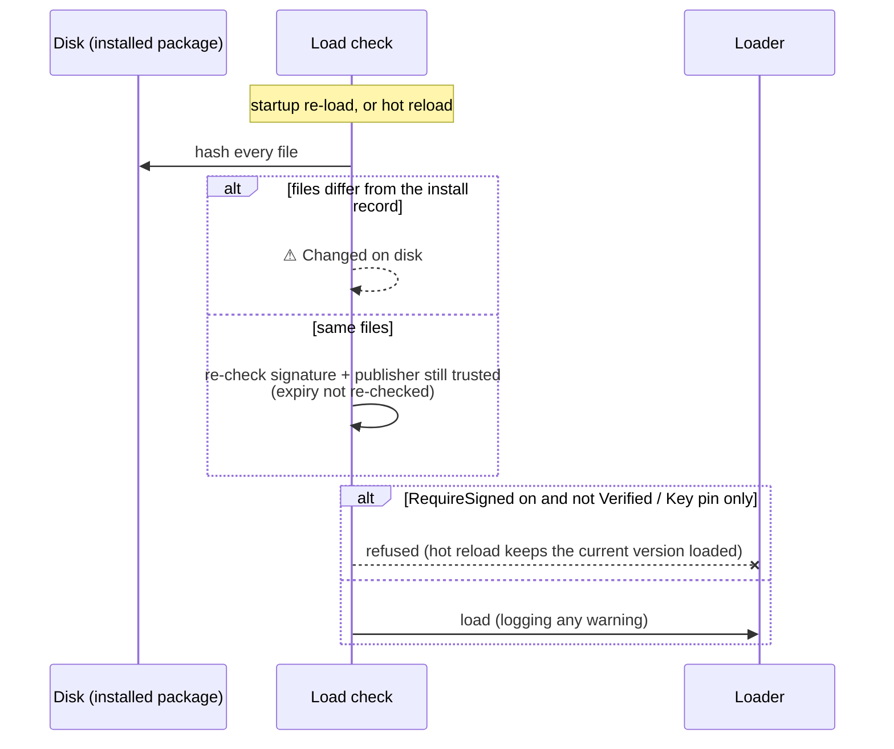

# Module signing — trusting who built a module

A module package (`.wfmod`) is code that runs inside the server, so it matters who built it.
DotFlow checks this with **signed packages**:
- the publisher signs the package's `module.json`;
- `module.json` lists the SHA-256 of every file in the package;
- so one signature vouches for every file.

A package signed by a publisher the server trusts shows as **Verified**.

> **Why not strong-name tokens?** Until Stage 7.4, `RequireSigned` only compared the entry DLL's
> strong-name *public key token* with a trusted list. A public key token isn't secret, and .NET
> doesn't verify strong-name signatures, so anyone can build a DLL that carries your token. That
> check is still accepted, for existing setups, but it's shown as **Key pin only**: it isn't proof
> of who built the module.

---

## What's in a signed package

| File | What |
| --- | --- |
| `module.json` | The manifest. `contentHashes` lists **every** other file → base64 SHA-256. |
| `signature.p7s` | A detached CMS (PKCS#7) signature over the exact bytes of `module.json`, by the publisher's X.509 certificate. |
| everything else | The module's files (DLLs, `deps.json`, content). |

A signed package whose `contentHashes` miss any file is refused: an unlisted file wouldn't be
covered by the signature.

## What the server decides



| Trust | Shown as | `RequireSigned` off | `RequireSigned` on |
| --- | --- | --- | --- |
| Verified | ✔ Verified: *publisher* | installs | installs |
| Key pin only | 🔑 Key pin only | installs, with a warning | installs, with a warning |
| Untrusted signer | ⚠ Untrusted signer | installs, with a warning | **refused** |
| Unsigned | Unsigned | installs, with a warning | **refused** |
| Signature or hashes don't match | — | **refused** (tampered) | **refused** |

Certificates must be within their validity period **at install**.

## Every load is checked again

At install, DotFlow records every installed file's hash, and the trust it found, in
`.dotflow-install.json` next to the package. Each later load compares the files with that record:
- **startup** (re-loading installed packages);
- **hot reload** (`Modules:HotReload`).

The files on disk might have been changed, or the publisher might no longer be trusted.



- With `RequireSigned` **off**, a problem is logged as a warning, and the module shows
  **⚠ Changed on disk** (or Untrusted) in the module list.
- With `RequireSigned` **on**, the module isn't loaded at startup, and a hot reload is refused (the
  version already running stays).
- Certificate expiry is checked only at install, so an installed module keeps loading after its
  certificate expires.
- Removing a publisher from the trusted list takes effect at the next load.
- A package installed before Stage 7.4 has no install record. It's judged by its strong-name token,
  with a warning to reinstall it signed.
- Loose DLLs in hot-reload dev folders can only be judged by their strong-name token.

---

## Signing a module (publishers)

You need an X.509 certificate with its private key, as a `.pfx`, or as PEM certificate + key files.
For a self-managed setup, a self-signed certificate is fine: the server pins it by thumbprint.

```bash
openssl req -x509 -newkey rsa:3072 -sha256 -days 730 -nodes -subj "/CN=Acme Modules" -keyout acme.key.pem -out acme.crt.pem
```

### With the `dotflow-module` tool

The `Workflow.Tools.ModulePack` project builds the `dotflow-module` command (also packable as a
.NET tool). Put `module.json` and the module's files in a folder, then:

```bash
dotflow-module pack ./my-module --out my-module-1.2.0.wfmod --cert acme.crt.pem --key acme.key.pem
```

It writes `contentHashes` for every file into `module.json`, signs it, and zips the package. With a
`.pfx`, the password comes from an environment variable, never the command line:

```bash
DOTFLOW_SIGN_PASSWORD=… dotflow-module pack ./my-module --cert acme.pfx
```

(`--password-env NAME` picks another variable; `--chain intermediate.pem` includes intermediates.)

Check a package the way a server would:

```bash
dotflow-module verify my-module-1.2.0.wfmod --trust acme.crt.pem
```

`--trust` takes a certificate file or a thumbprint, and `--trust-root` a CA root. The command exits
0 only when the signer is trusted.

### With plain OpenSSL

1. Write every file's hash into `module.json`'s `contentHashes` (path → base64 SHA-256):

   ```bash
   openssl dgst -sha256 -binary lib/My.Module.dll | base64
   ```

2. Sign `module.json` (detached, binary, SHA-256):

   ```bash
   openssl cms -sign -binary -md sha256 -in module.json -signer acme.crt.pem -inkey acme.key.pem -outform DER -out signature.p7s
   ```

3. Zip `module.json`, `signature.p7s` and the files (paths as in `contentHashes`) into the `.wfmod`.

Don't change `module.json` after signing, not even whitespace: the signature is over its exact
bytes. (Stage 7.4 checked this recipe end to end against DotFlow's verifier.)

---

## Trusting publishers (administrators)

### In the UI: Settings → Trusted publishers

- **Pinned publishers:** add a publisher by its certificate (PEM) or its SHA-256/SHA-1 thumbprint.
- **CA roots:** add a root certificate (PEM); any certificate it issued is trusted, after the chain
  and validity are checked.
- **Revocation checking:** for CA-issued certificates, online. Off by default.

Saving needs the **Admin** role and is recorded under *Changes*. Entries from the server's
configuration are shown with 🔒 and can't be removed there.

The module list shows a trust badge on every installed module, and the upload dialog shows who
signed a package.

### In server configuration (locked)

```jsonc
"Modules": {
  "Security": {
    "RequireSigned": true,
    "TrustedPublishers": {
      "Certificates": [
        { "Name": "Acme Modules", "Thumbprint": "A2C1A21C7100D32DBE4DF7A022D3DB4AA4B1BEDCAB1199E67E64222A9022DB85" }
      ],
      "RootCertificates": [
        { "Name": "Acme Root CA", "Pem": "-----BEGIN CERTIFICATE-----\n…\n-----END CERTIFICATE-----" }
      ],
      "CheckRevocation": false
    },
    "TrustedPublicKeyTokens": [ ]   // the older strong-name check (key pin only)
  }
}
```

With `RequireSigned` on and no publishers configured, the server warns at startup: only key-pinned
modules could install.

### API

| Method | Path | Who | What |
| --- | --- | --- | --- |
| GET | `/api/v1/settings/module-publishers` | read access | publishers and CA roots (server ones locked), `checkRevocation`, `requireSigned` |
| PUT | `/api/v1/settings/module-publishers` | Admin | save the editable ones (validated: thumbprint length, PEM, a thumbprint matching its PEM, locked revocation setting) |
| GET | `/api/v1/settings/module-publishers/audit` | Admin | change history |

`GET /api/v1/modules` and the upload response include
`trust: { status, publisher, thumbprint, trustSource, messages, checkedAt }` for installed packages.
`status` is one of `verified`, `keyPinOnly`, `unsigned`, `untrusted` or `changedOnDisk`.

---

## Alternatives if we want to change this

Decided 2026-11-09 (plan 07, Stage 7.4). These are the options we didn't pick, each with what would
change.

- **Docs-only:** keep token pinning and only document what it means. Cheapest, but nothing proves
  authorship.
  - *Change:* drop `PackageSignatureVerifier` from the installer; keep the "key pin only" wording.
- **Windows Authenticode** (`WinVerifyTrust`) on each DLL. It uses standard code signing, but it's
  **Windows only**, which rules out Linux containers.
  - *Change:* a Windows-only `IAssemblyVerifier`.
- **Cross-platform Authenticode** (parse each DLL's PE signature, hash and chain ourselves). It uses
  existing code-signing certificates, but there's much more to get right, and every DLL must be
  signed separately.
  - *Change:* an `IAssemblyVerifier` that does that, checked per DLL.
- **Admin approves an exact package hash** (no publisher identity). It's simple, but every new
  version needs approving.
  - *Change:* store approved SHA-256s; the installer checks them instead of a signature.
- **Raw ECDSA keys** instead of X.509 certificates: simpler keys, but no expiry, no CA and no
  standard tooling.
  - *Change:* the signature format and verifier.
- **Refuse on every load mismatch** (rather than warn unless `RequireSigned`).
  - *Change:* `ModulePackageInstaller.Gate` always refuses `ChangedOnDisk`.
- **Drop the strong-name token option**, or keep it only as an extra check that doesn't satisfy
  `RequireSigned`.
  - *Change:* `ModulePackageInstaller.Decide` stops returning `KeyPinOnly`, or
    `ModuleTrustInfo.SatisfiesRequireSigned` excludes it.
- **An MSBuild target** to pack and sign on build, instead of (or as well as) the CLI.
  - *Change:* a target wrapping `ModulePackageBuilder`.

---

*Where it lives:*
- **Core:** `Workflow.Modules/Security/PackageSignatureVerifier.cs`, `TrustedPublishers.cs` and
  `ModuleTrust.cs`; `Packaging/ModulePackageReader.cs`, `ModulePackageInstaller.cs` (`Decide`,
  `CheckInstalled`, `CheckBeforeLoad`, the install record) and `ModulePackageBuilder.cs`.
- **Hot reload:** `Loading/ModuleReloadService.cs`.
- **Server:** `Workflow.Api/Modules/TrustedPublisherService.cs` and
  `Workflow.Api/V1/TrustedPublisherEndpoints.cs`.
- **UI:** `Pages/TrustedPublishersSettings.razor`, `ModuleCard`, `UploadDialog`.
- **CLI:** `Workflow.Tools.ModulePack`.
- **Tests:** `Modules/Security/PackageSigningTests`, `ModulePackToolTests`,
  `Api/V1/TrustedPublisherApiTests`, and UI `Modules/Components/ModuleTrustUiTests`.
