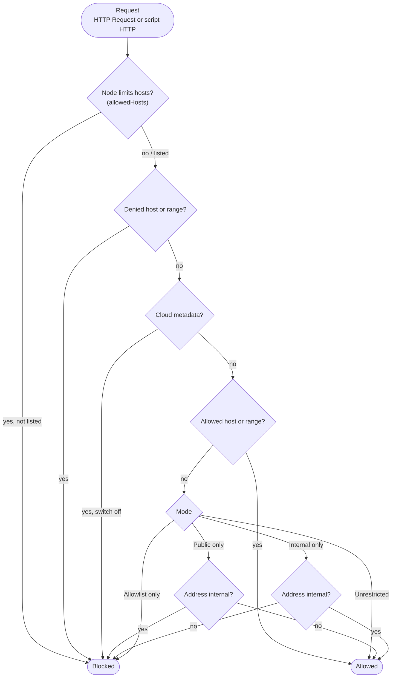
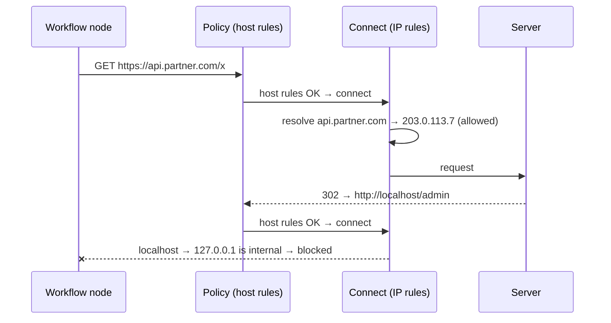

# Outbound HTTP — what workflows may call

Workflows make HTTP requests in two places:
- the **HTTP Request** module, including its OAuth2 token call;
- **script HTTP**: `workflow.httpGet / httpPost / httpPut / httpDelete` in JavaScript, Lua and C#.

When the URL comes from data (`{{input.url}}`, a webhook payload, a database row), a request can be
pointed at things it should never reach: `localhost`, internal services, or the cloud metadata
endpoint that hands out credentials. This is **server-side request forgery (SSRF)**.

The **outbound HTTP policy** decides what each of the two channels may call. Each channel has its
own settings, and a channel that sets nothing inherits the **Default**.

> ⚠️ **Upgrade note:** a channel nobody has configured runs as **Public only**. The public internet
> works, but **internal addresses (localhost, 10.x, 172.16–31.x, 192.168.x…) are blocked**. If your
> workflows call internal services, pick a mode under **Settings → Outbound HTTP** (or in
> `appsettings.json`) after upgrading. The server logs a warning at startup, and the designer shows
> a banner, until you do.

---

## Modes

| Mode | Internal addresses | Public internet | Typical deployment |
| --- | --- | --- | --- |
| **Public only** *(the default when unconfigured)* | ❌ unless listed | ✅ | cloud/SaaS: call public APIs, never the inside |
| **Internal only** | ✅ | ❌ unless listed | on-prem integration hub: inside freely, only named partners outside |
| **Allowlist only** | only listed | only listed | DMZ / locked down |
| **Unrestricted** | ✅ | ✅ | development |

"Internal" means:
- loopback (`127.0.0.0/8`, `::1`);
- private networks (`10/8`, `172.16/12`, `192.168/16`, `fc00::/7`);
- link-local (`169.254/16`, `fe80::/10`);
- carrier-grade NAT (`100.64/10`);
- multicast and reserved ranges.

Every mode also has four lists:

| List | Example | Effect |
| --- | --- | --- |
| Allowed hosts | `api.partner.com`, `*.partner.com` | always allowed (unless denied) |
| Allowed address ranges | `10.20.0.0/16`, `203.0.113.7` | always allowed (unless denied) |
| Denied hosts | `*.internal.corp` | **always blocked**: deny wins |
| Denied address ranges | `10.0.5.0/24` | **always blocked**: deny wins |

`*.partner.com` matches `api.partner.com` and `a.b.partner.com`, but not `partner.com` itself.

### Cloud metadata is its own switch

`169.254.169.254` (AWS/Azure/…), `fd00:ec2::254` and `metadata.google.internal` hand out machine
credentials. They are blocked in **every** mode, **Unrestricted included**, unless **Cloud
metadata = Allowed** is set for that channel. Listing them in the allowed hosts or ranges isn't
enough.



A blocked request fails the node with a message that names the host, the rule and where to change
it, for example:

> Outbound HTTP to 'localhost' was blocked by the HttpModule policy: 127.0.0.1 is an internal
> address and the mode is PublicOnly. An administrator can change this under Settings → Outbound
> HTTP, or in Http:Outbound:HttpModule.

Blocked requests are **not retried**, even when the node has a retry policy.

---

## How it's enforced (why redirects and DNS tricks don't get around it)

Rules are checked twice:
1. **Before every request, and before every redirect hop:** host-name rules (denied hosts, the
   node's `allowedHosts`, metadata names). Redirects are followed by the policy itself, up to 10 of
   them, so each hop is checked. Credentials (`Authorization`) aren't sent on to a different host.
2. **At the moment of connecting, on the actual IP address:** the mode, the address ranges and
   cloud metadata. So `http://my-innocent-name.com` that resolves to `10.0.0.5`, or a redirect to
   `http://localhost`, is judged by where it really goes.



**Known gap:** a C# script that a ScriptApprover approved for `System.Net` (see
[scripting](scripting.md)) can create its own `HttpClient` and bypass this policy. For defence in
depth, also restrict the server's outbound traffic at the network level (firewall, egress rules,
Kubernetes network policy).

**Proxies:** if the server sends traffic through an HTTP proxy, the connect-time check sees the
proxy's address, not the destination's. Host-name rules still apply. List the proxy under allowed
hosts if the mode would block it.

---

## Narrowing per node (DMZ edge)

An HTTP Request node or script node can set **Allowed hosts** (`allowedHosts`, e.g.
`["api.partner.com"]`). That node may then *only* call those hosts, on top of the channel's
policy. It **narrows, never widens**: a host the policy blocks stays blocked.

---

## Setting it up

### In the UI: Settings → Outbound HTTP

There's one card for **HTTP Request**, one for **Script HTTP** and one for **Default** (used by a
channel that doesn't set a value). Each card has the mode, the four lists and the cloud metadata
switch.
- **Saving needs the Admin role.** Each save is recorded under **Changes** (who, when, what). Every
  server picks it up within a minute.
- **Check an address:** enter a URL to see whether it would be allowed for a channel, and why,
  address by address.
- Values set in the server's configuration (below) are shown with 🔒 and **can't be changed** from
  the UI.

### In server configuration (locks the value)

```jsonc
"Http": {
  "Outbound": {
    "Default":    { "Mode": "PublicOnly" },
    "Scripts":    { "Mode": "AllowlistOnly", "AllowedHosts": [ "api.partner.com" ] },
    "HttpModule": { "Mode": "InternalOnly", "AllowedHosts": [ "*.partner.com" ], "DeniedCidrs": [ "10.0.5.0/24" ],
                    "AllowCloudMetadata": false }
  }
}
```

Environment variables work too, e.g. `Http__Outbound__Scripts__Mode=AllowlistOnly`.

**Precedence, per setting:** server configuration for the channel, then server configuration
`Default`, then the UI for the channel, then the UI `Default`, then the built-in default (Public
only, metadata blocked). Anything the server configuration sets is locked in the UI.

### API

| Method | Path | Who | What |
| --- | --- | --- | --- |
| GET | `/api/v1/settings/outbound-http` | read access | effective, saved and locked values per channel |
| PUT | `/api/v1/settings/outbound-http` | Admin | save (locked fields and invalid hosts/ranges are refused with reasons) |
| POST | `/api/v1/settings/outbound-http/check` | write access | `{ "channel": "Scripts", "url": "…" }` → allowed?, why, per address |
| GET | `/api/v1/settings/outbound-http/audit` | Admin | change history |

`GET /api/v1/status` includes `outboundHttp: { scripts: { mode, configured }, httpModule: { … } }`.

---

## Alternatives if we want to change this behavior

Decided 2026-11-09 (plan 06, Stage 7.3). These are the options we didn't pick, each with what would
change.

- **Unconfigured = Unrestricted + warnings** instead of failing closed. Nothing breaks on upgrade,
  but it's unsafe until an admin acts.
  - *Change:* `EffectiveOutboundPolicy.UnconfiguredMode` → `Unrestricted`.
  - The test setups that register an `Unrestricted` provider could then drop it.
- **No modes, just allow/deny lists** (an empty allow list means "anything not denied"). Simpler,
  but "block everything internal" means listing the private ranges yourself.
  - *Change:* drop `Mode` and decide in `OutboundHttpRules.CheckAddress` from the lists alone.
- **Metadata as an ordinary internal address,** or allowed simply by listing it.
  - *Change:* remove the `IsCloudMetadata` / `MetadataHostNames` checks, or move them below the
    allow lists, in `OutboundHttpRules`.
- **One shared policy for both channels** instead of separate ones.
  - *Change:* resolve both channels from one layer (or set only `Default`).
  - The separate named clients can stay.
- **Check the URL only, no connect-time check** (redirects off). Simpler, but a public name that
  resolves to a private address gets through.
  - *Change:* drop the `ConnectCallback` in `OutboundHttp.CreatePrimaryHandler`, and turn
    redirect-following off in `OutboundPolicyHandler`.
- **Per-node settings that can widen the policy** (rejected: it would let any workflow author lift
  the protection).
- **No UI, server configuration only** (the original v2 plan).
  - *Change:* remove the setup page and the PUT endpoint.
  - The provider would then read host settings only (`StaticOutboundHttpPolicyProvider`).

---

*Where it lives:*
- **Core (rules and enforcement):** `Workflow.Core/Http/OutboundHttpPolicy.cs`,
  `OutboundHttpRules.cs` and `OutboundHttpHandlers.cs`.
- **Server:** `Workflow.Api/Http/OutboundHttpPolicyService.cs` and
  `Workflow.Api/V1/OutboundHttpEndpoints.cs`.
- **Clients:** `dotflow.http` (HTTP Request) and `dotflow.script.http` (scripts) in
  `HttpModuleServiceCollectionExtensions`.
- **UI:** `Pages/OutboundHttpSettings.razor` and the designer banner.
- **Tests:** `Workflow.Tests/Http/OutboundHttpRulesTests`, `OutboundHttpEnforcementTests`,
  `Api/V1/OutboundHttpSettingsTests`, and UI `Components/OutboundHttpUiTests`.
